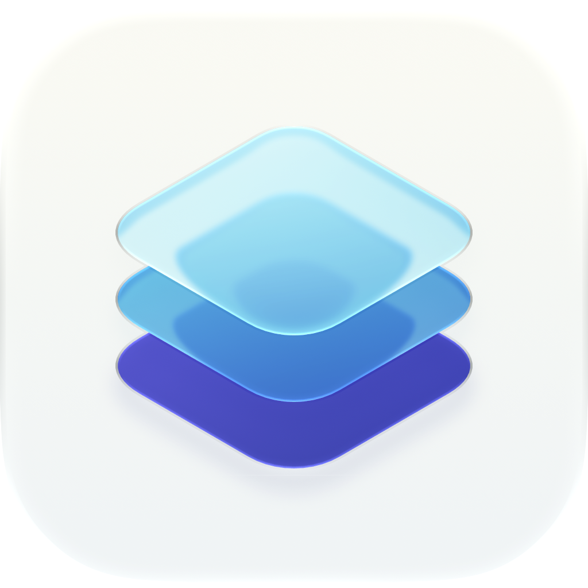
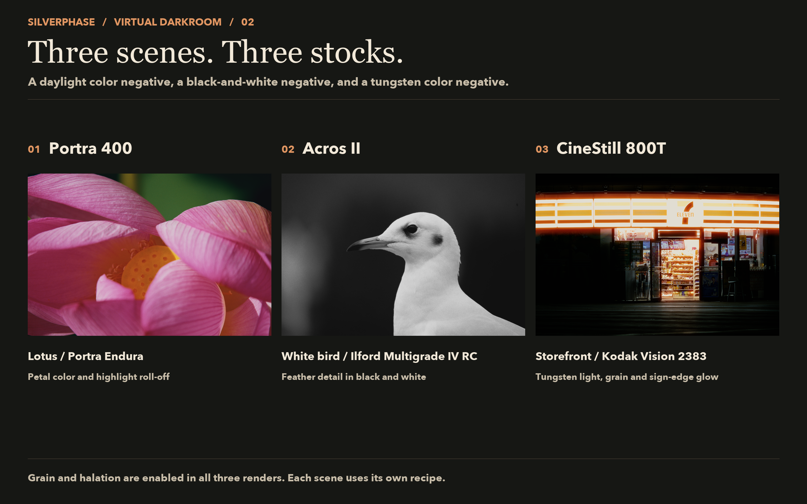
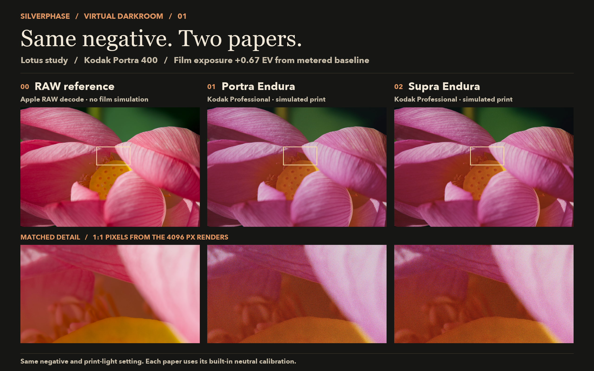
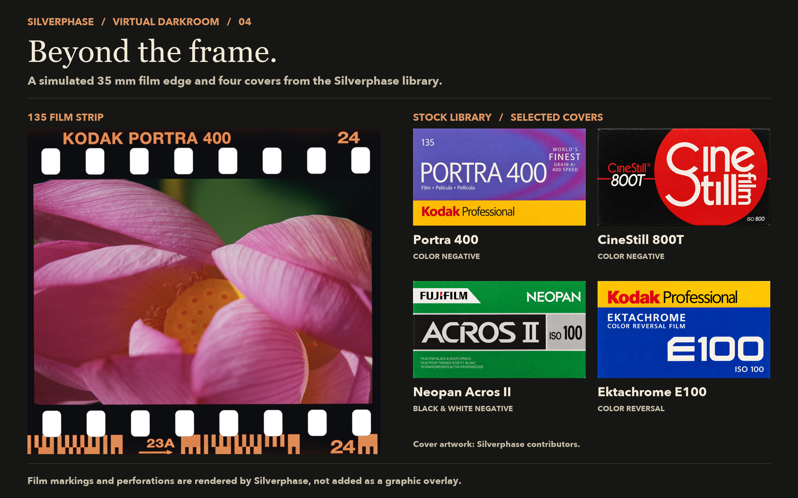

<p align="center">
  
</p>

<h1 align="center">Silverphase</h1>

<p align="center">
  <strong>From film exposure to the finished print.</strong><br>
  Native film and print simulation for macOS, iPhone, and iPad
</p>

<p align="center">
  <a href="README.md">简体中文</a> · English ·
  <a href="docs/site/en.html">Website source</a> · <a href="#download">Download</a> · <a href="#examples">Examples</a> · <a href="#editing-workflow">Workflow</a> ·
  <a href="#release-notes">Release notes</a> · <a href="docs/README.md">Documentation</a>
</p>

Silverphase is an open-source, on-device darkroom for **macOS, iPhone, and iPad**. Take a photo through **camera input → film exposure → development → printing → scanning**. Changing the paper can change the result without changing the negative. Grain, halation, and film edges are formed inside the process.

## Download

| Platform | Download | Requirements |
|---|---|---|
| macOS | [1.3.1 (build 6)](https://github.com/akinal5765-byte/Silverphase/releases/tag/macos-v1.3.1) · Apple silicon DMG | macOS 15 or later |
| iPhone and iPad | [App Store](https://apps.apple.com/us/app/silverphase-film-simulator/id6829987567) · [TestFlight beta](https://testflight.apple.com/join/uwY3ZYJp) | iOS or iPadOS 18 or later |

On macOS, check for updates in Settings → Software Update. The GitHub DMG uses an ad-hoc signature and has no Apple notarization. [Installation and checksum guide](docs/BINARY-RELEASES.md)

The iPhone and iPad app is available on the App Store outside mainland China. The App Store and TestFlight each show the version available through that channel.

## Also by the author: Layerlight

<table>
  <tr>
    <td width="112" align="center"><a href="https://apps.apple.com/app/id6756343255"></a></td>
    <td>
      <strong>Layerlight · Quick photo lighting for iPhone and iPad</strong><br>
      A separate, proprietary app by the same author.
      <p>Adjust the light in an everyday photo in a few taps, then compare with the original. Photographic Styles editing is a bonus on compatible devices and systems; some features require Pro.</p>
      <a href="https://apps.apple.com/app/id6756343255"><strong>View on the App Store →</strong></a> · <a href="https://www.youtube.com/shorts/F1xEDz2V0ms">Watch the 27-second demo</a>
    </td>
  </tr>
</table>

Layerlight and its icon retain their separate rights and are outside Silverphase's open-source licences. See the [related-app artwork notice](screenshots/related-apps/README.md) for the icon's provenance.

## Examples

### Three scenes, three stocks

[](docs/showcase/02-film-studies.png)

These are three independent Silverphase renders, not a controlled stock comparison. Grain and halation are enabled.

<details>
<summary>See the paper comparison, 1:1 night detail, and the 35 mm film edge</summary>

**Same negative, two papers.** Compare the RAW reference with Portra Endura and Supra Endura prints from the same Portra 400 negative. The lower row crops the same coordinates at 1:1 in each render.

[](docs/showcase/01-paper-study.png)

**After dark with CineStill 800T.** The storefront is rendered at 7008 × 4672 px. The sign and pavement crops show the native detail without upscaling.

[](docs/showcase/03-800t-night.png)

**Beyond the frame.** A Silverphase-rendered 135 film edge with perforations and frame markings, alongside four covers from the app.

[](docs/showcase/04-film-edge-covers.png)

</details>

Each finished card is 2560 × 1600 px (16:10). [Recipes, source and artwork notes](docs/showcase/README.md) · [Earlier desktop UI captures](screenshots/current/README.md) · [iPhone layout captures](screenshots/ios/2026-11-02/README.md)

## Editing workflow

1. **Open a photo.** Use a rendered image or a supported RAW original. RAW compatibility depends on the Apple system decoder.
2. **Choose materials.** The public catalog contains 25 standard film profiles, 9 papers, and 29 experimental films. Print a negative or select a direct scan. Ilford Multigrade IV RC supports grades 00–5. [Full catalog](modern_UI/Spektrafilm/Spektrafilm/Resources/StockCatalog.json) · [Experimental profile provenance and scope](license/DATA-SOURCES.md#experimental-fotufilm-profiles)
3. **Adjust the process.** Control metering, white balance, development, grain, halation, physical frame size, and print filtration. Add film edges and date stamps.
4. **Export.** Deliver a JPEG, 8-bit PNG, or 16-bit TIFF with your chosen color profile. The Cineon DI package provides a 16-bit log TIFF plus ProPhoto RGB and Rec.709 viewing LUTs for grading. [Export and DI guide](modern_UI/Spektrafilm/README.md#图像与输出边界)

## Platform features

### macOS

Work with folders, soft-proof images, and create two-photo half-frame compositions. Simulation Size lets you set the long edge after cropping so grain and halation are generated at the target size. Lightroom Classic can hand off a single JPEG or TIFF copy, and Save writes the full-resolution result back to that copy. The input retains Lightroom’s tone rendering. [macOS guide](modern_UI/Spektrafilm/README.md) · [Lightroom Classic workflow](docs/LIGHTROOM-CLASSIC.md)

### iPhone and iPad

Import from Photos or Files, or use the in-app camera. The editor has a local library, ratings and flags, batch editing and export, and layouts for conventional iPhones, iPhone Duo, and iPad. [iOS guide](ios/README.md) · [Controls and device limitations](ios/CONTROL-AUDIT.md)

## Release notes

The current source version is **1.3.1**. macOS, iOS, and iPadOS move metering and film exposure into Film, add cover art and source badges for all 29 public Fotufilm profiles, and reduce DIR edge overshoot in 17 of those profiles.

| Platform | 1.3.1 source notes |
|---|---|
| macOS (build 6) | [Changes and verification](modern_UI/Spektrafilm/releases/1.3.1.md) |
| iOS and iPadOS (build 11) | [Changes and verification](ios/releases/1.3.1.md) |

| Platform | 1.3.0 release notes |
|---|---|
| macOS (build 5) | [GitHub Release](https://github.com/akinal5765-byte/Silverphase/releases/tag/macos-v1.3.0) · [Changes and Kodak 5219 validation](modern_UI/Spektrafilm/releases/1.3.0.md) |
| iOS and iPadOS (build 10) | [GitHub Release](https://github.com/akinal5765-byte/Silverphase/releases/tag/v1.3.0) · [Source and validation notes](ios/releases/1.3.0.md) |

On both platforms, 1.3.0 adds pre-film controls, camera preview brightness matching for supported RAW files, and XMP star ratings in JPEG, PNG and TIFF exports. The shared catalogue adds 29 experimental film profiles, and the shared engine updates spectral adaptation, DIR, neutral print filtration, and grain softness. Existing edits retain their saved legacy tone settings.

## Documentation and builds

Both hosts use SwiftUI and a shared C++20/Metal engine. Python is used by development scripts. Image processing runs on the device.

```sh
git clone https://github.com/akinal5765-byte/Silverphase.git
cd Silverphase
export DEVELOPER_DIR=/Applications/Xcode-27.1.app/Contents/Developer

SILVERPHASE_LOCAL_MATERIALS=0 engine/build.sh bundle
SILVERPHASE_LOCAL_MATERIALS=0 xcodebuild \
  -project modern_UI/Spektrafilm/Spektrafilm.xcodeproj \
  -scheme Spektrafilm -configuration Debug -derivedDataPath build/DerivedData build
open build/DerivedData/Build/Products/Debug/Silverphase.app
```

See the [iOS guide](ios/README.md) for the project, device signing, and simulator builds. For architecture and verification, see the [documentation index](docs/README.md), [shared engine architecture](ARCHITECTURE.md), and [validation guide](modern_UI/Spektrafilm/VALIDATION.md). Report issues on [GitHub](https://github.com/akinal5765-byte/Silverphase/issues) or see the [contribution guide](CONTRIBUTING.md).

## Acknowledgements and licences

- [spektrafilm](https://github.com/andreavolpato/spektrafilm) · Thank you to Andrea Volpato for the physical model of film exposure, development, and printing, and the original measured film and paper data.
- [SpektraLab](https://github.com/JamesQiu2005/SpektraLab) · Thank you to Hanze Qiu for bringing the spektrafilm model into an interactive film simulation tool. Silverphase is an independent derivative of SpektraLab.
- [Negs](https://github.com/noahhaasis/negs) · Thank you to Noah Haasis for Negs and to [yosoyelchris](https://github.com/yosoyelchris) for contributing pre-film controls and camera brightness matching. Thank you to MUAStudio’s [Fotufilm](https://fotufilm.com) for the original experimental film profiles.

[Licences and credits](LICENSES.md) · [Material data sources](license/DATA-SOURCES.md)

<details>
<summary>What Silverphase 1.3.0 draws on from Negs</summary>

- **Pre-film controls and camera brightness matching** · We drew on Negs’s tone, detail, and color adjustments and its use of the camera preview to fit each RAW file’s starting exposure. [Negs Prep](https://github.com/noahhaasis/negs/blob/479a5674bb9d43af5c08fbd7307b367bec7bf10b/docs/prep.md) · [Negs credits](https://github.com/noahhaasis/negs#credits)
- **Simulation Size and star ratings in exports** · We drew on Negs’s pre-film linear resampling and the practice of writing photo ratings to `xmp:Rating` in finished exports. [Negs Image Size](https://github.com/noahhaasis/negs/blob/479a5674bb9d43af5c08fbd7307b367bec7bf10b/docs/image-size.md) · [Negs library and export features](https://github.com/noahhaasis/negs#a-darkroom-in-a-window)
- **29 experimental film profiles** · We adopted Negs’s conversions of MUAStudio’s [Fotufilm](https://fotufilm.com) profiles and selected development and print parameters. [Profile sources and licensing](license/DATA-SOURCES.md#experimental-fotufilm-profiles) · [Pinned source and file provenance](engine/resources_product/UPSTREAM.json)
- **Shared engine calibration** · We drew on Negs’s implementation of the experimental Spektrafilm model for DIR saturation, Hanatos spectral-window normalization, and the neutral print filter solver. [DIR](https://github.com/noahhaasis/negs/blob/97d63aaebca9654b041211dea9eebd55dd12b878/crates/spektrafilm-model/src/couplers.rs) · [Spectral adaptation](https://github.com/noahhaasis/negs/blob/97d63aaebca9654b041211dea9eebd55dd12b878/crates/spektrafilm-core/src/spectral_service.rs) · [Print balance](https://github.com/noahhaasis/negs/blob/97d63aaebca9654b041211dea9eebd55dd12b878/crates/spektrafilm-core/src/print_balance.rs)
- **Stage-by-stage validation** · Negs’s verification approach informed Silverphase’s own Kodak 5219 checks for negative density, grain, and measured spectral patches. [Negs validation report](https://github.com/noahhaasis/negs/blob/479a5674bb9d43af5c08fbd7307b367bec7bf10b/docs/gpu-vs-cpu-quality.md) · [Silverphase’s 5219 checks](modern_UI/Spektrafilm/VALIDATION.md#5219-底片与光谱色样)

</details>
