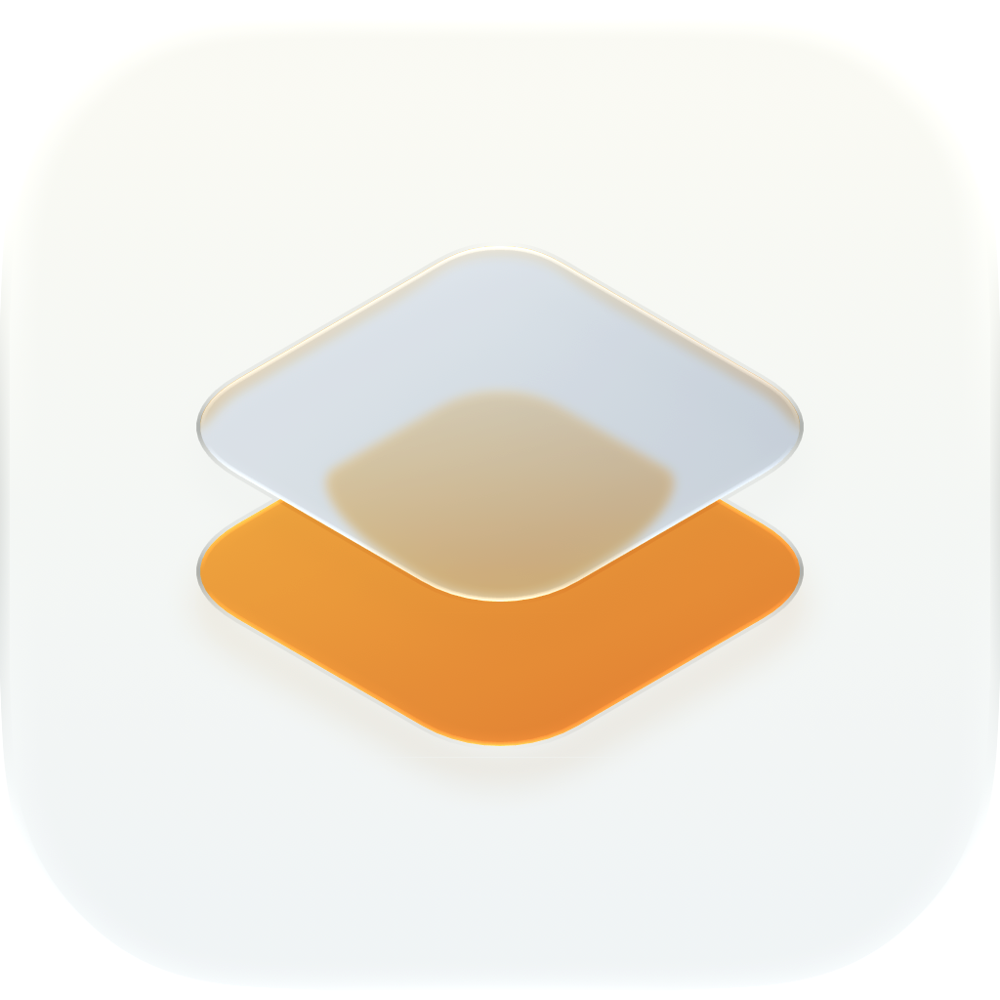
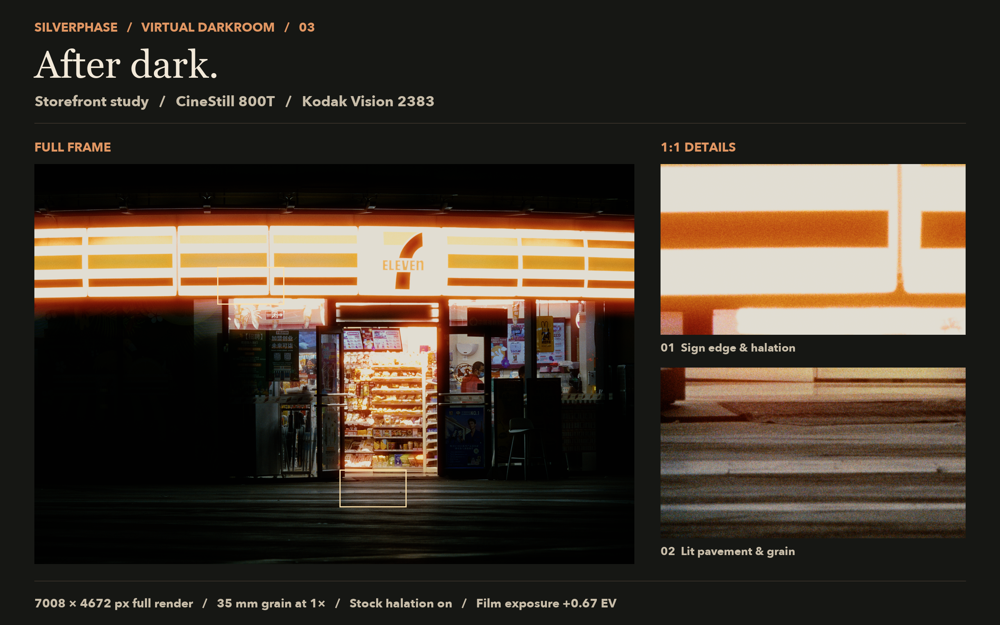
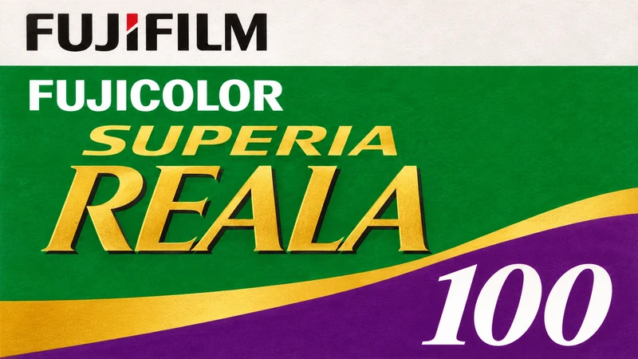
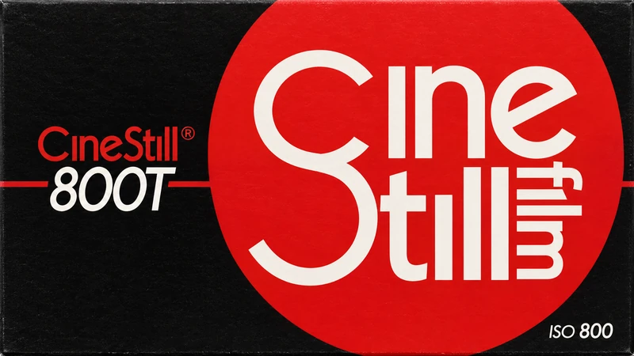
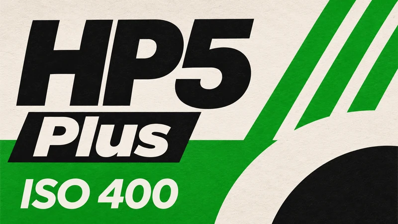
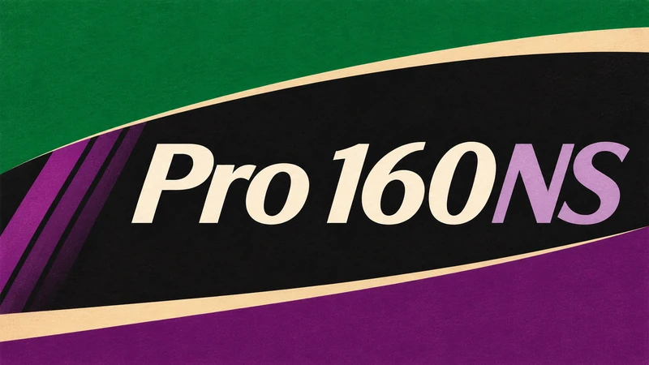
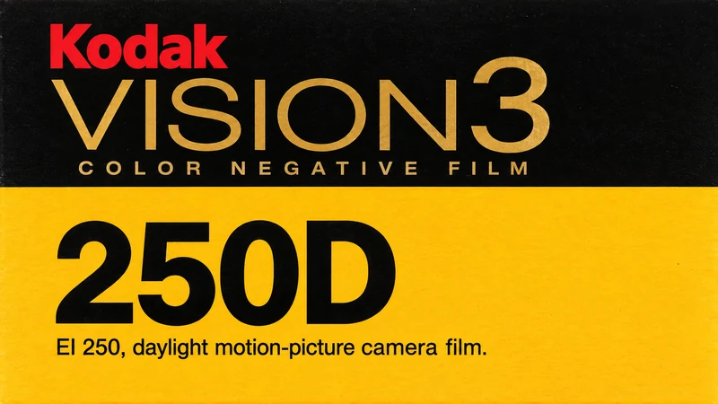
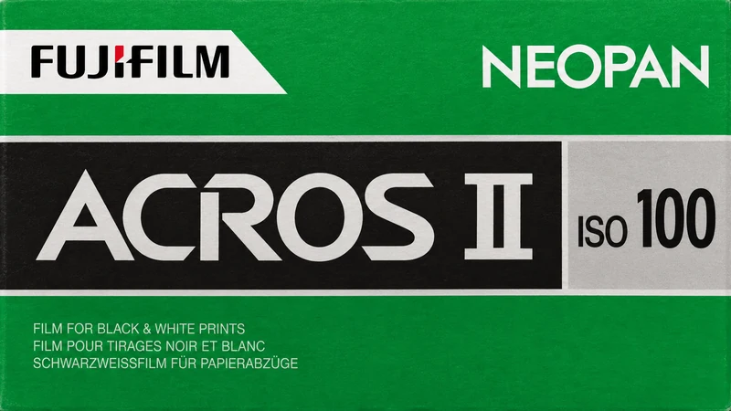

<p align="center">
  
</p>

<h1 align="center">Silverphase</h1>

<p align="center">
  <strong>Bring your photos into the darkroom.</strong><br>
  Native film and print simulation for macOS, iPhone, and iPad
</p>

<p align="center">
  <a href="README.md">简体中文</a> · English ·
  <a href="https://akinal5765-byte.github.io/Silverphase/site/en.html">Website</a> · <a href="#download">Download</a> · <a href="#also-by-the-author-layerlight">Layerlight</a> · <a href="#examples">Examples</a> · <a href="#film-cover-gallery">Film covers</a> · <a href="#editing-workflow">Workflow</a> ·
  <a href="#release-notes">Release notes</a> · <a href="docs/README.md">Documentation</a>
</p>

Silverphase is an **open-source, on-device darkroom** for **macOS, iPhone and iPad**.

### Same negative, two papers

One Portra 400 negative, two simulated prints: **Portra Endura** and **Supra Endura**. The paper changes; the negative and print exposure setting stay fixed. The left column is Apple’s RAW preview with no film simulation; the bottom row shows the same detail in each version.

[](docs/showcase/01-paper-study.png)

## Download

| Platform | Download | Requirements |
|---|---|---|
| macOS | [1.4.0 (build 7)](https://github.com/akinal5765-byte/Silverphase/releases/tag/macos-v1.4.0) · Apple silicon DMG | macOS 15 or later |
| iPhone and iPad | [App Store](https://apps.apple.com/app/id6829987567) · [TestFlight beta](https://testflight.apple.com/join/uwY3ZYJp) | iOS or iPadOS 18 or later |

On macOS, check for updates in Settings → Software Update. The GitHub DMG uses an ad-hoc signature and has no Apple notarization. [Installation and checksum guide](docs/BINARY-RELEASES.md)

For iPhone and iPad, the App Store and TestFlight each show the version available through that channel.

## Also by the author: Layerlight

<table>
  <tr>
    <td width="112" align="center"><a href="https://apps.apple.com/app/id6756343255"></a></td>
    <td>
      <strong>Layerlight · Quick photo lighting for iPhone and iPad</strong><br>
      A separate, proprietary app by the same author. Free to download, with paid Pro features.
      <p>Adjust the light in an everyday photo in a few taps, then compare with the original. On compatible devices and systems, Photographic Styles editing is also available.</p>
      <a href="https://apps.apple.com/app/id6756343255"><strong>View on the App Store →</strong></a> · <a href="https://www.youtube.com/shorts/F1xEDz2V0ms">Watch the 27-second demo</a>
    </td>
  </tr>
</table>

Layerlight and its icon retain their separate rights and are outside Silverphase's open-source licences. See the [related-app artwork notice](screenshots/related-apps/README.md) for the icon's provenance.

## Examples

### After dark with 800T: sign halation, pavement grain

[](docs/showcase/03-800t-night.png)

CineStill 800T printed on Kodak Vision 2383, rendered at **7008 × 4672 px**. The sign and pavement details are direct 1:1 crops, with no enlargement or extra sharpening. Grain and halation are part of the simulation.

<details>
<summary>See three film studies, a 135 film edge and stock-library artwork</summary>

**Three scenes, three stocks.** A Portra 400 lotus, an Acros II white bird and a CineStill 800T storefront. Each has its own recipe; these are examples, not a controlled comparison.

[](docs/showcase/02-film-studies.png)

**Beyond the frame.** Silverphase renders the perforations, edge markings and frame number in this 135 film edge. The four covers beside the strip are archived designs; the gallery below shows the redesign.

[](docs/showcase/04-film-edge-covers.png)

</details>

Each showcase card is **2560 × 1600 (16:10)**; click to see it at full size. These are simulated prints, not scans of physical prints. The original RAW files are not distributed. [Recipes, photo sources and artwork rights](docs/showcase/README.md) · [Archived desktop UI captures](screenshots/current/README.md) · [Archived iPhone layouts](screenshots/ios/2026-11-02/README.md)

## Film cover gallery

Eight covers from the redesigned Silverphase stock library, from daylight and tungsten color stocks to black-and-white. These are Silverphase illustrations, not scans of retail packaging. Click a card to see it at full size.

<table>
  <tr>
    <td width="25%" align="center"><a href="docs/site/covers/portra-400.webp"></a><br><sub>Kodak Portra 400</sub></td>
    <td width="25%" align="center"><a href="docs/site/covers/reala-100.webp"></a><br><sub>Fujifilm Reala 100</sub></td>
    <td width="25%" align="center"><a href="docs/site/covers/cinestill-800t.webp"></a><br><sub>CineStill 800T</sub></td>
    <td width="25%" align="center"><a href="docs/site/covers/hp5-plus.webp"></a><br><sub>Ilford HP5 Plus</sub></td>
  </tr>
  <tr>
    <td width="25%" align="center"><a href="docs/site/covers/eterna-500.webp"></a><br><sub>Fujifilm Eterna 500</sub></td>
    <td width="25%" align="center"><a href="docs/site/covers/pro-160ns.webp"></a><br><sub>Fujifilm Pro 160NS</sub></td>
    <td width="25%" align="center"><a href="docs/site/covers/vision3-250d.webp"></a><br><sub>Kodak Vision3 250D</sub></td>
    <td width="25%" align="center"><a href="docs/site/covers/acros-ii.webp"></a><br><sub>Fujifilm Acros II</sub></td>
  </tr>
</table>

## Editing workflow

Open a rendered image or an original RAW file supported by the Apple system decoder. On iPhone and iPad you can also import from Photos or use the in-app camera.

| Stage | Where to start |
|---|---|
| **Prep** | Adjust the input tone, exposure, detail and color before exposing the film. Supported RAW files can optionally match camera preview brightness here; preview matching is not a separate stage. |
| **Film** | Choose a stock and physical format, then set metering and manual film exposure. |
| **Development** | Shape the negative’s contrast and development. The simulation accounts for material effects such as grain and halation. |
| **Color Enlargement (Print)** | Choose a paper and adjust print exposure and filtration. Ilford Multigrade IV RC supports grades 00–5. |
| **Scan** | See the scanned output. Slide film and direct-scan recipes bypass paper. |

Crop (Geometry on Mac) and Film Edge are separate tools, not part of Scan. Export a JPEG, 8-bit PNG or 16-bit TIFF, or save a Cineon DI package with a 16-bit log TIFF and ProPhoto RGB / Rec.709 viewing LUTs. Exact controls and output limits depend on platform. [Export and DI guide](modern_UI/Spektrafilm/README.md#图像与输出边界)

The public catalog includes 25 standard film profiles, 9 papers and 29 experimental film profiles. [Material catalog](modern_UI/Spektrafilm/Spektrafilm/Resources/StockCatalog.json) · [Experimental profile provenance and scope](license/DATA-SOURCES.md#experimental-fotufilm-profiles) · [Cover prompts and provenance](modern_UI/design/film-artwork/README.md)

## Platform features

### macOS

Work with folders, soft-proof images, and create two-photo half-frame compositions. Simulation Size lets you set the long edge after cropping so grain and halation are generated at the target size. Lightroom Classic can hand off a single JPEG or TIFF copy, and Save writes the full-resolution result back to that copy. The input retains Lightroom’s tone rendering. [macOS guide](modern_UI/Spektrafilm/README.md) · [Lightroom Classic workflow](docs/LIGHTROOM-CLASSIC.md)

### iPhone and iPad

Import from Photos or Files, or use the in-app camera. The editor has a local library, ratings and flags, batch editing and export, and layouts for conventional iPhones, iPhone Duo, and iPad. [iOS guide](ios/README.md) · [Controls and device limitations](ios/CONTROL-AUDIT.md) · [Real-photo screenshots](screenshots/ios/2026-11-27/README.md)

## Release notes

**macOS 1.4.0 (build 7)** brings redesigned covers, custom film-edge text and less aggressive output gamut compression. [Release notes](modern_UI/Spektrafilm/releases/1.4.0.md) · [Keep your edits when upgrading](docs/MACOS-IDENTITY-UPGRADE.md).

**iOS and iPadOS 1.4.0 (build 12)** add a dedicated photo viewer with press-and-hold original comparison, quick film selection and photo information, plus file-format filters and smoother browsing in large libraries. On iPhone Duo, swipe through films in waist-level mode and see the viewfinder update as you scroll. [Version notes](ios/releases/1.4.0.md).

In 1.3.1, macOS, iOS, and iPadOS moved metering and film exposure into Film, added cover art and source badges for all 29 public Fotufilm profiles, and reduced DIR edge overshoot in 17 of those profiles.

| Platform | 1.3.1 source notes |
|---|---|
| macOS (build 6) | [Changes and verification](modern_UI/Spektrafilm/releases/1.3.1.md) |
| iOS and iPadOS (build 11) | [Changes and verification](ios/releases/1.3.1.md) |

| Platform | 1.3.0 release notes |
|---|---|
| macOS (build 5) | [GitHub Release](https://github.com/akinal5765-byte/Silverphase/releases/tag/macos-v1.3.0) · [Changes and Kodak 5219 validation](modern_UI/Spektrafilm/releases/1.3.0.md) |
| iOS and iPadOS (build 10) | [GitHub Release](https://github.com/akinal5765-byte/Silverphase/releases/tag/v1.3.0) · [Source and validation notes](ios/releases/1.3.0.md) |

On both platforms, 1.3.0 adds pre-film controls, camera preview brightness matching for supported RAW files, and XMP star ratings in JPEG, PNG and TIFF exports. The shared catalogue adds 29 experimental film profiles, and the shared engine updates spectral adaptation, DIR, neutral print filtration, and grain softness. Existing edits retain their saved legacy tone settings.

## Documentation and builds

Both hosts use SwiftUI and a shared C++20/Metal engine. Python is used by development scripts. Image processing runs on the device.

```sh
git clone https://github.com/akinal5765-byte/Silverphase.git
cd Silverphase
export DEVELOPER_DIR=/Applications/Xcode-27.1.app/Contents/Developer

SILVERPHASE_LOCAL_MATERIALS=0 engine/build.sh bundle
SILVERPHASE_LOCAL_MATERIALS=0 xcodebuild \
  -project modern_UI/Spektrafilm/Spektrafilm.xcodeproj \
  -scheme Spektrafilm -configuration Debug -derivedDataPath build/DerivedData build
open build/DerivedData/Build/Products/Debug/Silverphase.app
```

See the [iOS guide](ios/README.md) for the project, device signing, and simulator builds. For architecture and verification, see the [documentation index](docs/README.md), [shared engine architecture](ARCHITECTURE.md), and [validation guide](modern_UI/Spektrafilm/VALIDATION.md). Report issues on [GitHub](https://github.com/akinal5765-byte/Silverphase/issues) or see the [contribution guide](CONTRIBUTING.md).

## Acknowledgements and licences

- [spektrafilm](https://github.com/andreavolpato/spektrafilm) · Thank you to Andrea Volpato for the physical model of film exposure, development, and printing, and the original measured film and paper data.
- [SpektraLab](https://github.com/JamesQiu2005/SpektraLab) · Thank you to Hanze Qiu for bringing the spektrafilm model into an interactive film simulation tool. Silverphase is an independent derivative of SpektraLab.
- [Negs](https://github.com/noahhaasis/negs) · Thank you to Noah Haasis for Negs and to [yosoyelchris](https://github.com/yosoyelchris) for contributing pre-film controls and camera brightness matching. Thank you to MUAStudio’s [Fotufilm](https://fotufilm.com) for the original experimental film profiles.

[Licences and credits](LICENSES.md) · [Material data sources](license/DATA-SOURCES.md)

<details>
<summary>What Silverphase 1.3.0 draws on from Negs</summary>

- **Pre-film controls and camera brightness matching** · We drew on Negs’s tone, detail, and color adjustments and its use of the camera preview to fit each RAW file’s starting exposure. [Negs Prep](https://github.com/noahhaasis/negs/blob/479a5674bb9d43af5c08fbd7307b367bec7bf10b/docs/prep.md) · [Negs credits](https://github.com/noahhaasis/negs#credits)
- **Simulation Size and star ratings in exports** · We drew on Negs’s pre-film linear resampling and the practice of writing photo ratings to `xmp:Rating` in finished exports. [Negs Image Size](https://github.com/noahhaasis/negs/blob/479a5674bb9d43af5c08fbd7307b367bec7bf10b/docs/image-size.md) · [Negs library and export features](https://github.com/noahhaasis/negs#a-darkroom-in-a-window)
- **29 experimental film profiles** · We adopted Negs’s conversions of MUAStudio’s [Fotufilm](https://fotufilm.com) profiles and selected development and print parameters. [Profile sources and licensing](license/DATA-SOURCES.md#experimental-fotufilm-profiles) · [Pinned source and file provenance](engine/resources_product/UPSTREAM.json)
- **Shared engine calibration** · We drew on Negs’s implementation of the experimental Spektrafilm model for DIR saturation, Hanatos spectral-window normalization, and the neutral print filter solver. [DIR](https://github.com/noahhaasis/negs/blob/97d63aaebca9654b041211dea9eebd55dd12b878/crates/spektrafilm-model/src/couplers.rs) · [Spectral adaptation](https://github.com/noahhaasis/negs/blob/97d63aaebca9654b041211dea9eebd55dd12b878/crates/spektrafilm-core/src/spectral_service.rs) · [Print balance](https://github.com/noahhaasis/negs/blob/97d63aaebca9654b041211dea9eebd55dd12b878/crates/spektrafilm-core/src/print_balance.rs)
- **Stage-by-stage validation** · Negs’s verification approach informed Silverphase’s own Kodak 5219 checks for negative density, grain, and measured spectral patches. [Negs validation report](https://github.com/noahhaasis/negs/blob/479a5674bb9d43af5c08fbd7307b367bec7bf10b/docs/gpu-vs-cpu-quality.md) · [Silverphase’s 5219 checks](modern_UI/Spektrafilm/VALIDATION.md#5219-底片与光谱色样)

</details>
