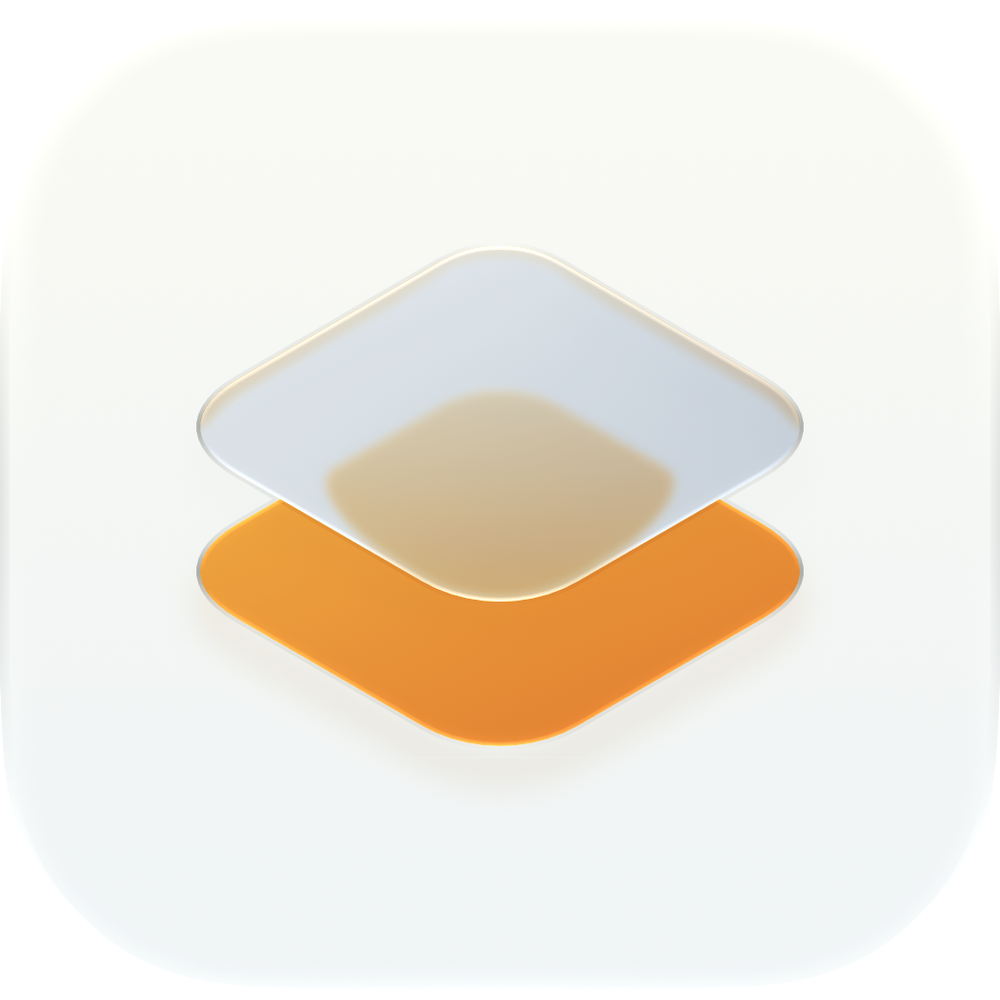
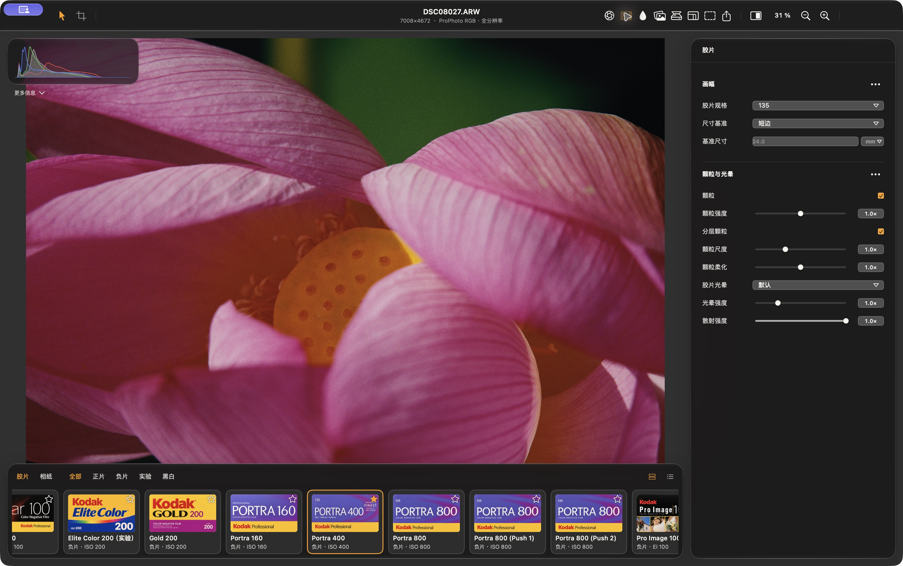
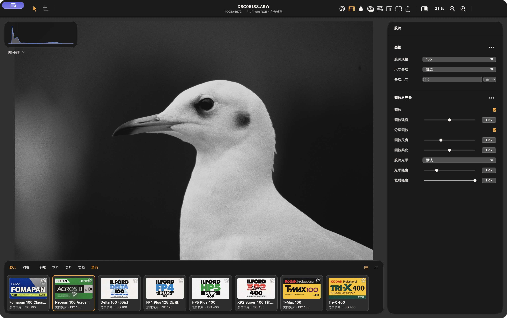
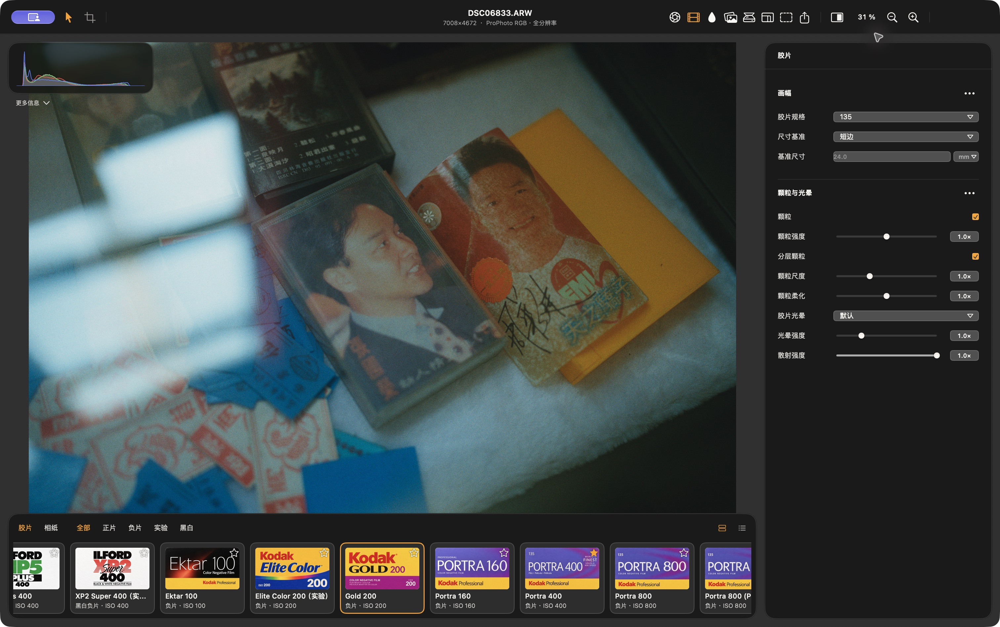
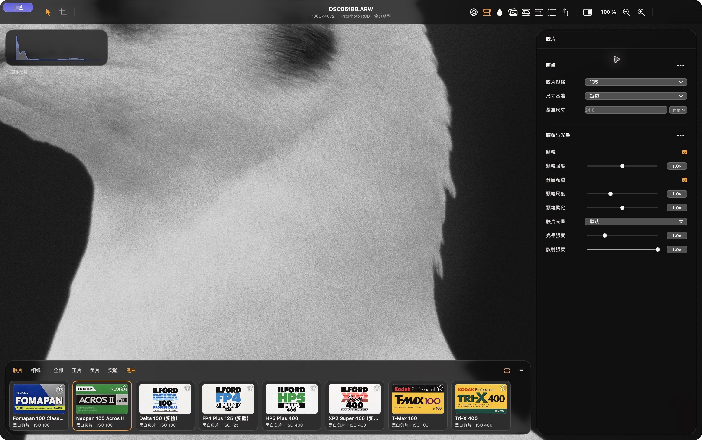
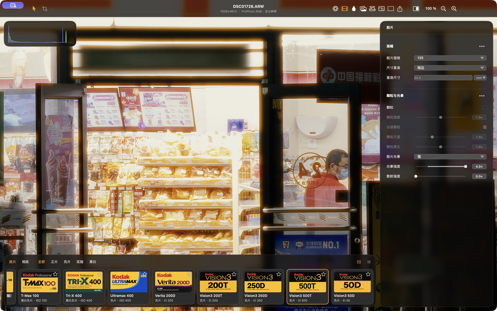
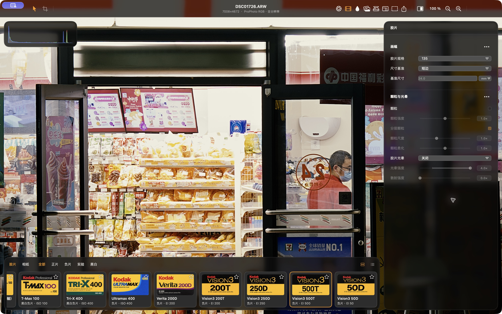
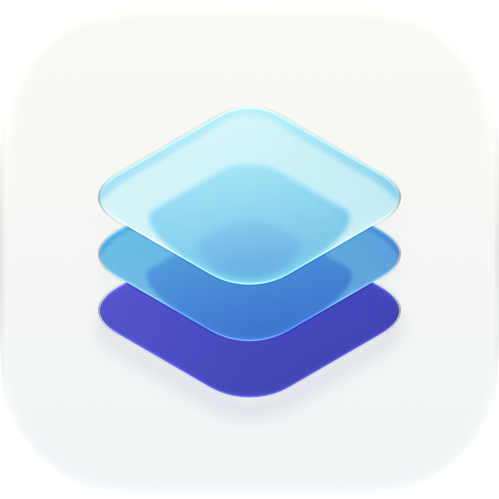

<p align="center">
  
</p>

<h1 align="center">Silverphase</h1>

<p align="center">
  <strong>从胶片曝光，到相纸成像。</strong><br>
  面向 macOS、iPhone 与 iPad 的原生胶片工艺模拟器
</p>

<p align="center">
  <a href="README.md">简体中文</a> · <a href="README.en.md">English</a> ·
  <a href="#安装与构建">安装与构建</a> · <a href="screenshots/current/README.md">界面案例</a> ·
  <a href="docs/README.md">文档</a> · <a href="CONTRIBUTING.md">参与开发</a> · <a href="#也试试-layerlight">Layerlight</a>
</p>



Silverphase 将照片送入**相机输入 → 胶片 → 显影 → 印相 → 扫描**的流程。选择胶片与相纸，再通过曝光、显影反差、滤色和物理画幅塑造画面；颗粒、光晕与片边在同一条成像流程中形成。你可以交付完成的照片，也可以导出保留胶片反差的中间文件，继续在其他软件中调色。

应用采用 SwiftUI 与共享的 C++20／Metal 引擎，在设备上处理照片，运行时不需要 Python 服务或虚拟环境。Silverphase 是 Hanze Qiu 的 [SpektraLab](https://github.com/JamesQiu2005/SpektraLab) 的独立衍生项目，物理模型与原始实测胶片／相纸配置来自 Andrea Volpato 的 [spektrafilm](https://github.com/andreavolpato/spektrafilm)。

## 可以做什么

- **选择胶片与相纸。** 公开目录包含 24 款胶片配置（含 Push 变体）和 9 款相纸，覆盖彩色负片、正片、电影负片与黑白材料。
- **控制曝光与显影。** 使用测光、胶片曝光、RAW 白平衡、显影反差、色彩分离及场景宽容度置放，调整照片如何落到胶片响应范围内。
- **塑造颗粒与光晕。** 物理画幅参与颗粒及空间效果的尺度换算；颗粒强度、尺度、柔化、胶片光晕与乳剂散射分别可调。
- **完成彩色或黑白印相。** 调整相纸、印相曝光、黄／品红滤色、预闪与印相眩光；Ilford Multigrade IV RC 支持 00–5 级纸号及曝光补偿，镜头提供八种 Wratten 滤镜。
- **加入片边与日期。** 支持 135、半格、多种 120 和全景片门，以及片孔、边印、灰雾和漏光；日期后背按所选画幅提供相应位置与样式。
- **检查并交付成片。** 使用裁切、旋转、直方图、对比预览、批量导出及导出配方；桌面另提供软打样和双照片半格组合。

### 胶片与相纸

| 材料类别 | 代表配置 |
|---|---|
| 彩色负片 | Portra 160／400／800、Gold 200、Ektar 100、Ultramax 400、Fujifilm C200、Pro 400H、X-Tra 400 |
| 正片 | Ektachrome 100、Kodachrome 64、Provia 100F、Velvia 100 |
| 电影负片 | Vision3 50D、200T、250D、500T |
| 黑白负片 | Tri-X 400、HP5 Plus 400、T-Max 100、Acros II |
| 彩色相纸与电影印片 | Endura 系列、Ektacolor Edge、Crystal Archive Type II、Vision 2383、Vision Premier 2393 |
| 黑白相纸 | Ilford Multigrade IV RC |

完整列表见[材料目录](modern_UI/Spektrafilm/Spektrafilm/Resources/StockCatalog.json)。黑白配置沿用 SpektraLab 的独立建模及拟合；其化学工艺、颗粒与拟合限制见[黑白配置说明](engine/tools/profile_sources/blackwhite.md)。

### 界面与细节

<table>
  <tr>
    <td width="50%"></td>
    <td width="50%"></td>
  </tr>
  <tr><td align="center">Acros II · 黑白印相</td><td align="center">Gold 200 · 磁带与唱片陈列</td></tr>
</table>

<details>
<summary>展开查看：100% 颗粒细节与光晕开关对比</summary>

**颗粒细节：** Acros II、135 画幅，应用缩放 100%，颗粒强度、尺度及柔化均为 1×。



**光晕对比：** Vision3 500T，同一曝光与视角，仅切换光晕。开启图使用强／4×，乳剂散射为 0×，颗粒关闭。

| 光晕开启 | 光晕关闭 |
|---|---|
|  |  |

请打开原图查看细节。页面缩放和 JPEG 压缩会影响细小纹理；这组截图用于展示视觉效果，不是无损测量样本。

</details>

以上均为 2026-10-31 的真实 macOS 窗口截图。案例设置、来源及使用范围见[完整案例页](screenshots/current/README.md)。

## 平台与当前状态

| 平台 | 系统要求 | 当前范围 |
|---|---|---|
| macOS | Apple Silicon，macOS 15+ | 原生编辑器、共享成像引擎、批量导出、软打样、双照片半格组合 |
| iPhone | iOS 18+ | 原生触控编辑器、照片／文件导入、共享工艺控制、裁切与导出 |
| iPad | iPadOS 18+ | 同一移动编辑器，适配画布、检查器及材料浏览器布局 |

发布构建可从 [GitHub Releases](https://github.com/akinal5765-byte/Silverphase/releases) 获取：macOS DMG 无 Developer ID 签名且未公证；iOS IPA 需自行重新签名与安装。下载、校验和安装方法见[二进制发布说明](docs/BINARY-RELEASES.md)。也可从源码构建。iOS 尚未覆盖桌面的双照片半格组合及全部校样功能，详细边界见 [iOS 指南](ios/README.md)和[控制对照](ios/CONTROL-AUDIT.md)。局部蒙版尚未开放。

iOS 当前采用会话编辑：冷启动会清理应用内导入副本，设置和导出配方独立保留。请保留原始照片与导出成片；长期归档工作流见各平台说明。

## 也试试 Layerlight

<table>
  <tr>
    <td width="112" align="center"><a href="https://apps.apple.com/cn/app/layerlight-hdr-photo-editor/id6756343255"></a></td>
    <td>
      <strong>Layerlight · HDR 图片编辑器</strong><br>
      同一作者开发的独立闭源应用，已在 App Store 上架，支持 iPhone 与 iPad。
      <p>调整 HDR 高光与 Gain Map 光影层，控制光感、反差和柔和度；支持 HEIC 摄影风格工作流，并提供裁切、画框、水印与批量导出等功能。摄影风格编辑需要受支持的设备和系统；部分功能需 Pro。</p>
      <a href="https://apps.apple.com/cn/app/layerlight-hdr-photo-editor/id6756343255"><strong>在 App Store 查看与下载 →</strong></a>
    </td>
  </tr>
</table>

Layerlight 的应用与图标保留其独立权利，不适用 Silverphase 的开源许可。图标来源见[相关应用素材说明](screenshots/related-apps/README.md)。

## 安装与构建

直接使用请前往 [Releases](https://github.com/akinal5765-byte/Silverphase/releases) 下载对应平台附件，按[安装说明](docs/BINARY-RELEASES.md)操作。下面是源码构建方式。

### macOS

需要 Apple Silicon Mac、Xcode 及其 Metal 工具链，并有可用的 `python3` 运行开发脚本。当前验证使用 Xcode 27.1。Xcode 工程已提交，无需安装 Python 运行环境或重新生成工程。

```bash
git clone https://github.com/akinal5765-byte/Silverphase.git
cd Silverphase

# 按实际 Xcode 安装路径调整；无需更改全局 xcode-select。
export DEVELOPER_DIR=/Applications/Xcode-27.1.app/Contents/Developer

engine/build.sh bundle
xcodebuild -project modern_UI/Spektrafilm/Spektrafilm.xcodeproj \
  -scheme Spektrafilm -configuration Debug \
  -derivedDataPath build/DerivedData build

open build/DerivedData/Build/Products/Debug/Silverphase.app
```

目录与 target 中的 `Spektrafilm` 是保留的内部工程名称，应用显示名为 **Silverphase**。修改引擎资源或 Metal shader 后，请重新运行 `engine/build.sh bundle`。默认本地构建使用开发用签名。

### iPhone 与 iPad

用 Xcode 打开 `ios/Silverphase/Silverphase.xcodeproj`，选择 `Silverphase` scheme 和设备，在 Signing & Capabilities 中设置自己的开发团队后构建运行。真机描述文件需包含项目请求的 Increased Memory Limit 能力。模拟器构建无需开发者签名：

```bash
xcodebuild -project ios/Silverphase/Silverphase.xcodeproj \
  -scheme Silverphase -configuration Debug -sdk iphonesimulator \
  -derivedDataPath /tmp/silverphase-ios-derived CODE_SIGNING_ALLOWED=NO build
```

设备签名、构建缓存与诊断说明见 [iOS 构建指南](ios/README.md)。

公开 checkout 默认只含正式材料。维护者若有私人实验素材，本地构建可另外加载；对外打包时设置 `SILVERPHASE_LOCAL_MATERIALS=0`。详见[本地素材与公开构建](docs/LOCAL-MATERIALS.md)。

## 第一次使用

1. **导入照片。** 桌面打开照片或文件夹；移动端从系统照片或文件导入。支持 RAW、JPEG、HEIC／HEIF、PNG 和 TIFF；RAW 兼容性取决于系统的 Apple RAW 解码器。
2. **选择胶片与相纸。** 从材料浏览器选胶片，再选择印相相纸；正片或“不使用相纸”可查看直扫结果。
3. **按工艺调整。** 先处理输入曝光与白平衡，再调显影、颗粒、光晕和印相。裁切与片边一起预览。
4. **选择交付方式。** 导出可直接使用的成片，或输出供后续调色的胶片中间文件。

### 导出方式

| 路径 | 输出 | 适合用途 |
|---|---|---|
| Finished Film Render | JPEG、8-bit PNG、16-bit TIFF；按配方写入目标色彩配置 | 完成胶片／相纸流程，直接查看、分享或交付 |
| Gradeable Film Intermediate / DI package | 16-bit Cineon 对数 TIFF 与配套 DI 视图 LUT | 保留胶片反差，继续进行颜色处理 |

<details>
<summary>DI 文件的颜色语义</summary>

DI 主图是**未附 ICC 标签、使用 ProPhoto RGB 原色的 16-bit Cineon 对数 TIFF**，绕过相纸印相及后期输出调色。第二页为视图预览；目录附带转 ProPhoto RGB 与 Rec.709 的两个 `.cube` 视图 LUT，每个导出目录共享一份。

使用配套视图解释主图，不要直接给对数数据指定普通显示 ICC。这些是 DI 观看变换，不是所选相纸的印相 LUT。通过普通 JPEG／TIFF 路径导出 DI 时，得到的是带目标配置的显示视图。文件约定见[桌面工程说明](modern_UI/Spektrafilm/README.md)。

</details>

## 文档与开发

| 想了解什么 | 入口 |
|---|---|
| 全部文档及当前规范 | [文档索引](docs/README.md) |
| macOS 结构、构建与导出 | [桌面工程说明](modern_UI/Spektrafilm/README.md) |
| iOS 行为、构建与功能差异 | [iOS 指南](ios/README.md) · [控制对照](ios/CONTROL-AUDIT.md) |
| 共享引擎与原生调用边界 | [架构](ARCHITECTURE.md) · [API](API-SPEC-callable-render-service.md) · [契约](CONTRACT-frontend-backend.md) |
| 测试、固定照片与跳过项 | [验证指南](modern_UI/Spektrafilm/VALIDATION.md) · [发布审查](docs/OPEN-SOURCE-RELEASE.md) |
| 问题反馈与贡献 | [Issues](https://github.com/akinal5765-byte/Silverphase/issues) · [贡献指南](CONTRIBUTING.md) |

运行桌面测试：

```bash
xcodebuild -project modern_UI/Spektrafilm/Spektrafilm.xcodeproj \
  -scheme SpektrafilmTests -configuration Debug \
  -derivedDataPath build/DerivedData test
```

当前验收使用原生引擎检查和应用工作流；真实照片按外部清单验证，不进入 Git。缺少历史素材时部分测试会跳过，报告需同时记录通过、失败与跳过项。历史 Python 参考脚本保留作研究记录，当前构建和验收不需要重建其运行环境。

## 来源与许可

感谢 **Hanze Qiu** 创建 SpektraLab 的原生 macOS 应用与 C++／Metal 移植，感谢 **Andrea Volpato** 创建 spektrafilm 的物理模型及原始实测配置。Silverphase 保留上游 Git 历史、署名和许可证，在此基础上独立开发；上游项目未参与或背书 Silverphase。

- 应用、引擎与开发工具：**GPL-3.0-or-later**。
- 胶片／相纸配置、衍生 LUT 与相关拟合包：沿用上游 **CC BY-SA 4.0**。
- Apple metal-cpp：**Apache-2.0**；Colour 数据保留 **BSD-3-Clause** 声明。
- Silverphase 自有封面与图标：权利范围及第三方包装例外见[素材声明](license/ARTWORK.md)。案例照片及 Layerlight 图标单独说明，不适用该素材授权。

完整条款、数据来源及分发要求见 [LICENSES.md](LICENSES.md)、[许可目录](modern_UI/Spektrafilm/Spektrafilm/Resources/Licenses/)及[来源记录](license/DATA-SOURCES.md)。
