<p align="center">
  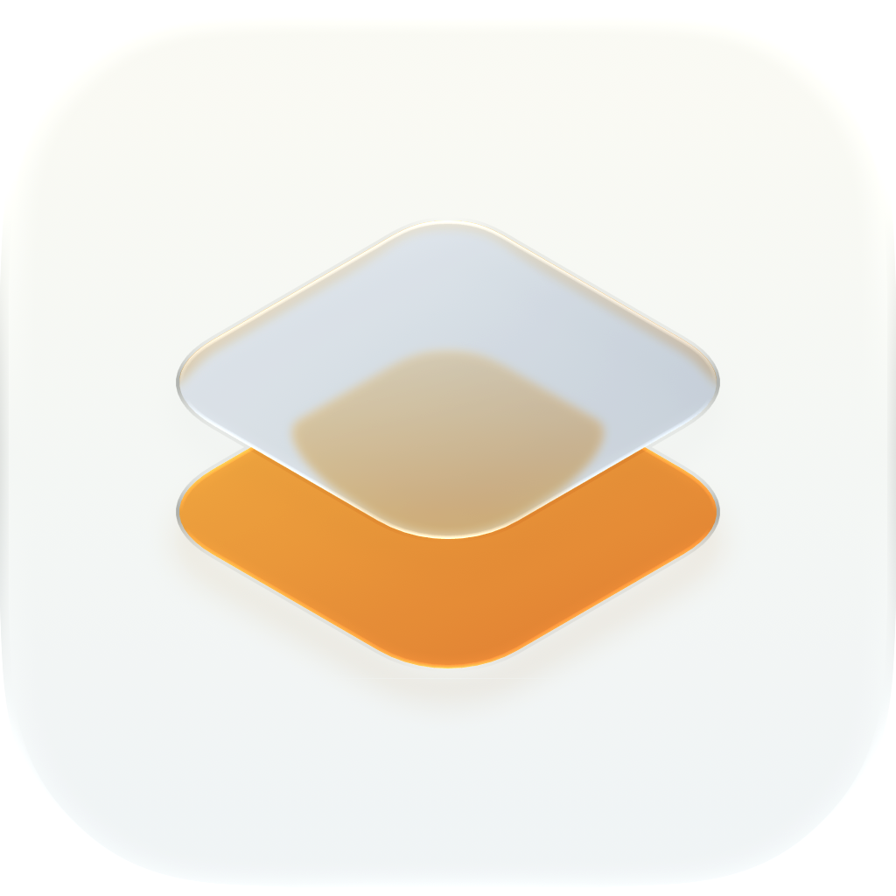
</p>

<h1 align="center">Silverphase</h1>

<p align="center">
  <strong>把照片带进暗房。</strong><br>
  面向 macOS、iPhone 和 iPad 的原生胶片工艺模拟器
</p>

<p align="center">
  简体中文 · <a href="README.en.md">English</a> ·
  <a href="https://akinal5765-byte.github.io/Silverphase/">官网</a> · <a href="#下载">下载</a> · <a href="#也试试-layerlight">Layerlight</a> · <a href="#效果案例">效果案例</a> · <a href="#胶片封面">胶片封面</a> · <a href="#编辑流程">编辑流程</a> ·
  <a href="#版本记录">版本记录</a> · <a href="docs/README.zh-CN.md">文档</a>
</p>

Silverphase 是一间在设备上运行的**开源数字暗房**，适用于 **macOS、iPhone 和 iPad**。

### 同一张底片，两种相纸

同一张荷花的 **Portra 400** 模拟底片，分别印到 **Portra Endura** 和 **Supra Endura**。相纸变了，底片和印相曝光设定不变。左边是 Apple 解码、未经过胶片模拟的 RAW 参考；下排是同位置的细节。

[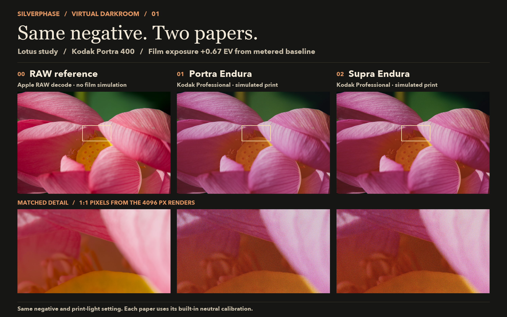](docs/showcase/01-paper-study.png)

## 下载

| 平台 | 下载入口 | 系统要求 |
|---|---|---|
| macOS | [1.4.0（构建 7）](https://github.com/akinal5765-byte/Silverphase/releases/tag/macos-v1.4.0) · Apple Silicon DMG | macOS 15 或更高 |
| iPhone／iPad | [App Store](https://apps.apple.com/app/id6829987567) · [TestFlight 测试版](https://testflight.apple.com/join/uwY3ZYJp) | iOS／iPadOS 18 或更高 |

macOS 可在「设置 → 软件更新」检查新版。GitHub DMG 使用 ad-hoc 签名，未经 Apple 公证。[安装与校验指南](docs/BINARY-RELEASES.zh-CN.md)

iPhone 和 iPad 的可安装版本以 App Store 和 TestFlight 各自显示为准。

## 也试试 Layerlight

<table>
  <tr>
    <td width="112" align="center"><a href="https://apps.apple.com/cn/app/layerlight-hdr-photo-editor/id6756343255">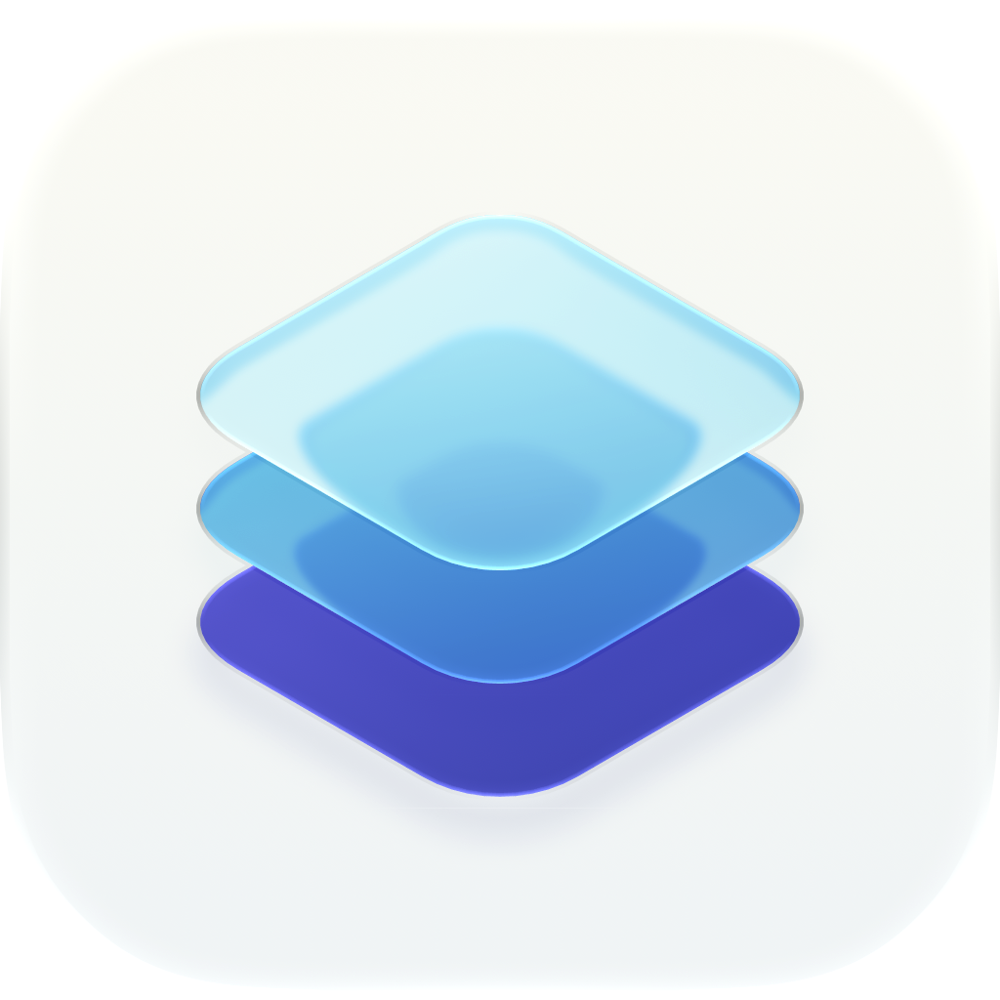</a></td>
    <td>
      <strong>Layerlight · 手机照片调光</strong><br>
      同一作者开发的独立闭源应用，适用于 iPhone 与 iPad。可免费下载，部分功能由付费 Pro 解锁。
      <p>几步把日常照片的光调到顺眼，还能和原图对比。兼容设备与系统上也可以编辑摄影风格。</p>
      <a href="https://apps.apple.com/cn/app/layerlight-hdr-photo-editor/id6756343255"><strong>在 App Store 查看与下载 →</strong></a> · <a href="https://www.youtube.com/shorts/F1xEDz2V0ms">观看 27 秒演示</a>
    </td>
  </tr>
</table>

Layerlight 的应用与图标保留其独立权利，不适用 Silverphase 的开源许可。图标来源见[相关应用素材说明](screenshots/related-apps/README.md)。

## 效果案例

### 800T 夜景：招牌的光晕，路面的颗粒

[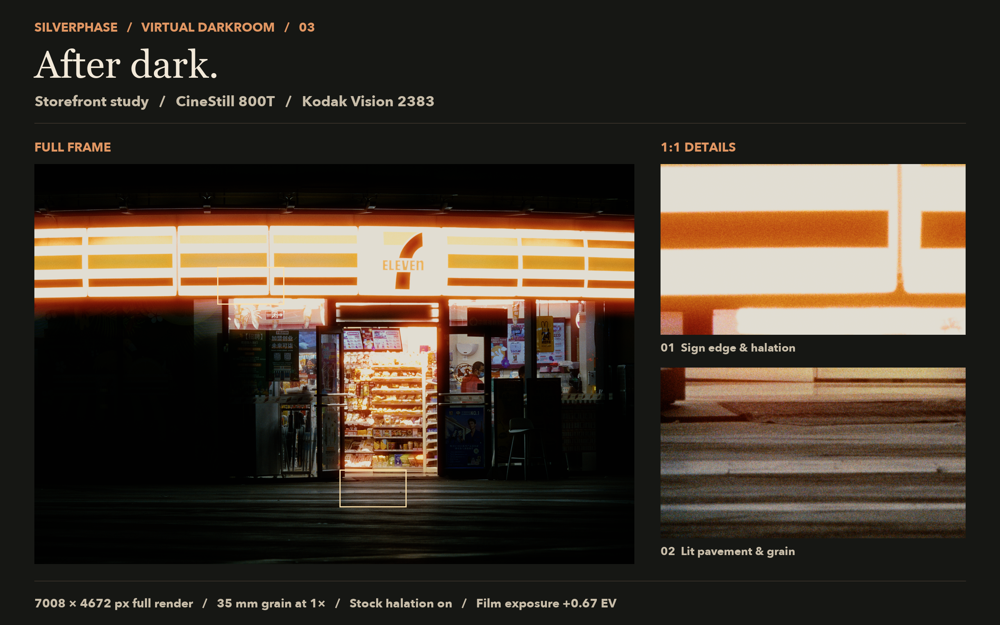](docs/showcase/03-800t-night.png)

CineStill 800T 搭配 Kodak Vision 2383。整张夜景以 **7008 × 4672 像素**渲染，招牌边缘和路面的局部直接从渲染像素提取，未放大或额外锐化。颗粒与光晕是模拟工艺本身的一部分。

<details>
<summary>展开看三款胶片样片、135 片边和材料库封面</summary>

**三个场景，三款胶片。** Portra 400 荷花、Acros II 白鸟、CineStill 800T 便利店。三个案例各有配方，不是同一场景换胶片的对比。

[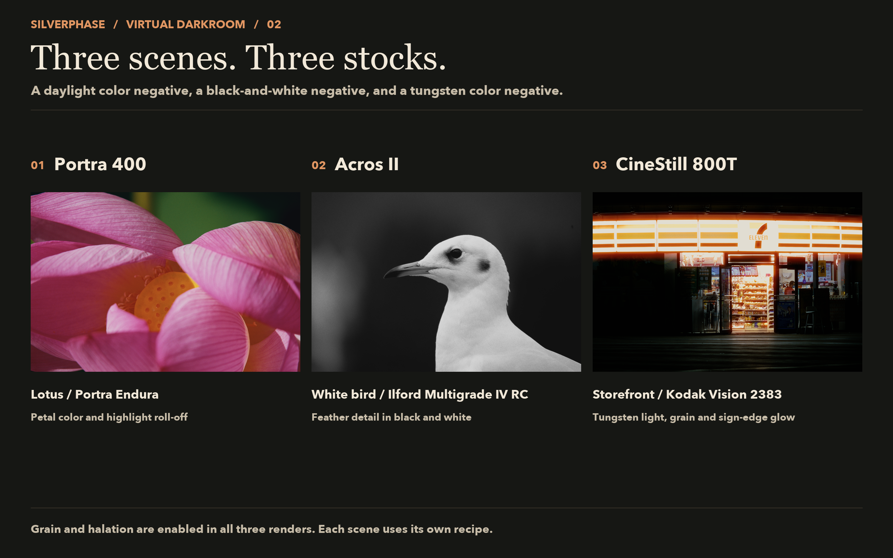](docs/showcase/02-film-studies.png)

**画幅之外。** Silverphase 渲染 135 片边的齿孔、边码与帧号，不是在画面外贴一层边框。旁边四张是历史存档；新版封面见下方展廊。

[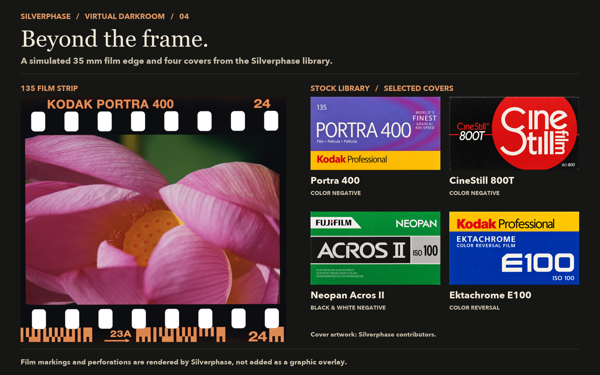](docs/showcase/04-film-edge-covers.png)

</details>

四张展示卡均为 **2560 × 1600（16:10）**；点击可看原尺寸。画面为软件模拟，不是实体相纸扫描；所用 RAW 不随仓库分发。[配方、照片来源与授权范围](docs/showcase/README.md) · [桌面界面存档](screenshots/current/README.md) · [iPhone 布局存档](screenshots/ios/2026-11-02/README.md)

## 胶片封面

从新版材料库挑了八张封面，涵盖日光型、灯光型和彩色与黑白胶片。它们是 Silverphase 为选片界面制作的插画，不是零售包装扫描。点击可查看大图。

<table>
  <tr>
    <td width="25%" align="center"><a href="docs/site/covers/portra-400.webp">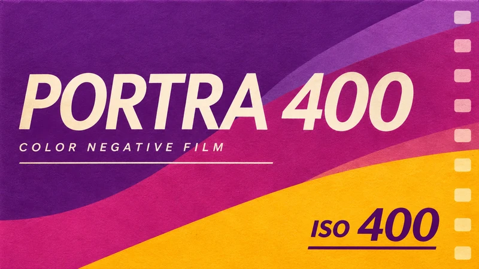</a><br><sub>Kodak Portra 400</sub></td>
    <td width="25%" align="center"><a href="docs/site/covers/reala-100.webp">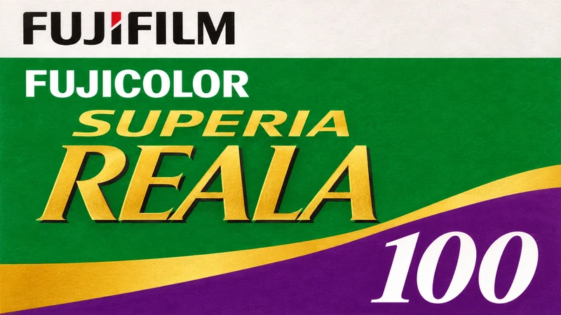</a><br><sub>Fujifilm Reala 100</sub></td>
    <td width="25%" align="center"><a href="docs/site/covers/cinestill-800t.webp">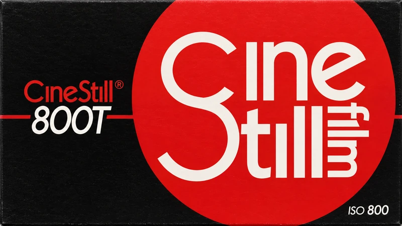</a><br><sub>CineStill 800T</sub></td>
    <td width="25%" align="center"><a href="docs/site/covers/hp5-plus.webp">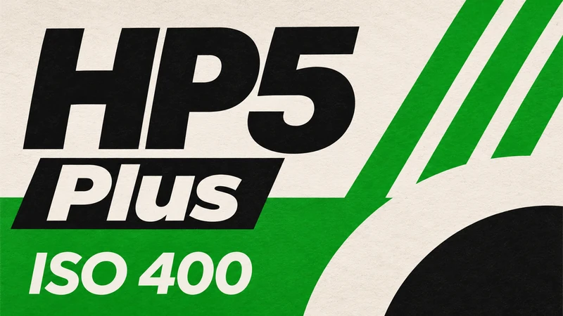</a><br><sub>Ilford HP5 Plus</sub></td>
  </tr>
  <tr>
    <td width="25%" align="center"><a href="docs/site/covers/eterna-500.webp">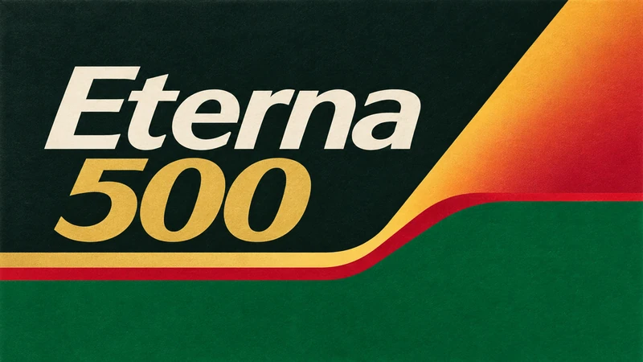</a><br><sub>Fujifilm Eterna 500</sub></td>
    <td width="25%" align="center"><a href="docs/site/covers/pro-160ns.webp">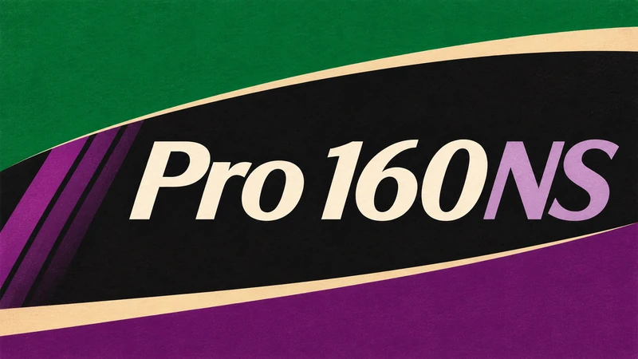</a><br><sub>Fujifilm Pro 160NS</sub></td>
    <td width="25%" align="center"><a href="docs/site/covers/vision3-250d.webp">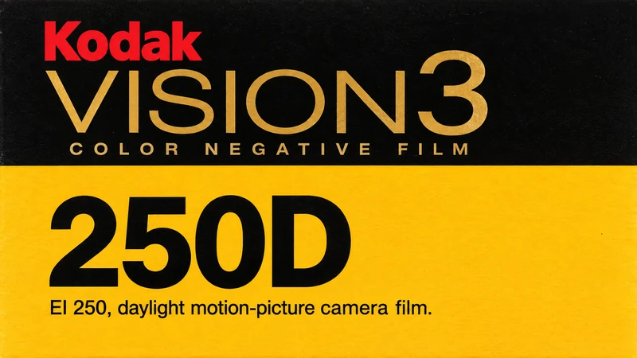</a><br><sub>Kodak Vision3 250D</sub></td>
    <td width="25%" align="center"><a href="docs/site/covers/acros-ii.webp">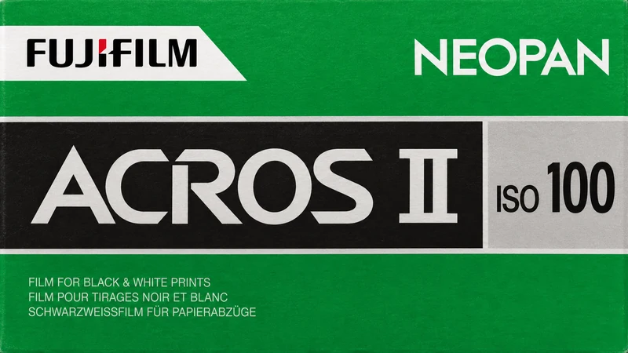</a><br><sub>Fujifilm Acros II</sub></td>
  </tr>
</table>

## 编辑流程

照片可从文件导入；iPhone 与 iPad 也可从系统「照片」导入或在应用内拍摄。RAW 兼容性取决于 Apple 的系统解码能力。

| 工艺 | 从哪里开始 |
|---|---|
| **预处理** | 在胶片曝光前调整入片影调、曝光、细节和色彩。受支持的 RAW 可选择匹配相机预览亮度；它是预处理选项，不是独立工艺。 |
| **胶片** | 选择材料与物理画幅，再调整测光和手动胶片曝光。 |
| **显影** | 调整底片的反差与显影表现。颗粒和光晕随材料与工艺形成。 |
| **彩色放大（印相）** | 选择相纸并调整印相曝光与滤色。Ilford Multigrade IV RC 支持 00–5 级纸号。 |
| **扫描** | 查看扫描与输出结果。正片或选择直扫的配方不经过相纸。 |

构图（裁切）和片边是独立工具，不是扫描的一步。成片可导出为 JPEG、8 位 PNG 或 16 位 TIFF；Cineon DI 提供 16 位对数 TIFF 和配套的 ProPhoto RGB／Rec.709 视图 LUT，便于后续调色。具体控件与输出条件因平台而异。[输出与 DI 说明](modern_UI/Spektrafilm/README.md#图像与输出边界)

公开目录含 25 款常规胶片、9 款相纸和 29 款实验胶片。[材料目录](modern_UI/Spektrafilm/Spektrafilm/Resources/StockCatalog.json) · [实验配置的来源与范围](license/DATA-SOURCES.md#experimental-fotufilm-profiles) · [封面提示词和出处](modern_UI/design/film-artwork/README.md)

## 各平台功能

### macOS

支持文件夹工作流、软打样和双照片半格组合。「模拟尺寸」可指定重裁切后的长边，让颗粒和光晕按目标尺寸生成。Lightroom Classic 可发送单张 JPEG 或 TIFF 副本，保存时全尺寸写回 Lightroom 登记的文件。输入保留 Lightroom 已渲染的影调。[macOS 指南](modern_UI/Spektrafilm/README.md) · [Lightroom Classic 工作流](docs/LIGHTROOM-CLASSIC.md)

### iPhone 与 iPad

可从「照片」或「文件」导入，也可直接拍摄。支持本地图库、评分与旗标、批量编辑与导出，并为常规 iPhone、iPhone Duo 和 iPad 提供各自的布局。[iOS 指南](ios/README.zh-CN.md) · [平台控制与设备限制](ios/CONTROL-AUDIT.md) · [真实照片界面截图](screenshots/ios/2026-11-27/README.md)

## 版本记录

| 版本 | 平台 | 构建 | 主要改动 | 说明 |
|---|---|---:|---|---|
| 1.4.0 | macOS | 7 | 新胶片封面、自定义片边文字、更温和的导出色域压缩。 | [发布说明](modern_UI/Spektrafilm/releases/1.4.0.md) · [迁移指南](docs/MACOS-IDENTITY-UPGRADE.md) |
| 1.4.0 | iOS / iPadOS | 12 | 独立看图页、原片对比、按格式筛选、大图库浏览优化、Duo 腰平滑动选片。 | [版本说明](ios/releases/1.4.0.md) |
| 1.3.1 | macOS | 6 | 测光和胶片曝光移到「胶片」，补齐 Fotufilm 封面与来源角标，并调整部分配置的 DIR。 | [源码与验证](modern_UI/Spektrafilm/releases/1.3.1.md) |
| 1.3.1 | iOS / iPadOS | 11 | 同步测光、胶片曝光和 Fotufilm 改动。 | [源码与验证](ios/releases/1.3.1.md) |
| 1.3.0 | macOS | 5 | 入片调整、相机预览亮度匹配、XMP 星级和共享引擎更新。 | [发布说明与 5219 验证](modern_UI/Spektrafilm/releases/1.3.0.md) |
| 1.3.0 | iOS / iPadOS | 10 | 加入入片调整、相机亮度匹配、XMP 星级和 29 款实验胶片。 | [源码与验证](ios/releases/1.3.0.md) |

[所有 GitHub 发布](https://github.com/akinal5765-byte/Silverphase/releases) · [下载安装与渠道说明](docs/BINARY-RELEASES.zh-CN.md)。

## 文档与构建

两端采用 SwiftUI 和共享 C++20／Metal 引擎。Python 用于开发脚本，应用运行在设备端。

```sh
git clone https://github.com/akinal5765-byte/Silverphase.git
cd Silverphase
export DEVELOPER_DIR=/Applications/Xcode-27.1.app/Contents/Developer

SILVERPHASE_LOCAL_MATERIALS=0 engine/build.sh bundle
SILVERPHASE_LOCAL_MATERIALS=0 xcodebuild \
  -project modern_UI/Spektrafilm/Spektrafilm.xcodeproj \
  -scheme Spektrafilm -configuration Debug -derivedDataPath build/DerivedData build
open build/DerivedData/Build/Products/Debug/Silverphase.app
```

iOS 工程、真机签名及模拟器命令见 [iOS 构建指南](ios/README.zh-CN.md)。了解应用结构和验证方式，请看[文档索引](docs/README.zh-CN.md)、[共享引擎架构](ARCHITECTURE.zh-CN.md)和[验证指南](modern_UI/Spektrafilm/VALIDATION.md)。反馈问题或参与开发，请到 [Issues](https://github.com/akinal5765-byte/Silverphase/issues) 或查看[贡献指南](CONTRIBUTING.zh-CN.md)。

## 致谢与许可

- [spektrafilm](https://github.com/andreavolpato/spektrafilm) · 感谢 Andrea Volpato 提供胶片曝光、显影和印相的物理模型，以及原始实测胶片与相纸数据。
- [SpektraLab](https://github.com/JamesQiu2005/SpektraLab) · 感谢 Hanze Qiu 将 spektrafilm 的模型发展为可交互的胶片模拟工具。Silverphase 是 SpektraLab 的独立衍生项目。
- [Negs](https://github.com/noahhaasis/negs) · 感谢 Noah Haasis 的项目，以及 [yosoyelchris](https://github.com/yosoyelchris) 为 Negs 带来的入片调整和相机亮度匹配。感谢 MUAStudio 的 [Fotufilm](https://fotufilm.com) 提供实验胶片配置来源。

[许可与署名](LICENSES.md) · [材料数据来源](license/DATA-SOURCES.md)

<details>
<summary>Silverphase 1.3.0 借鉴 Negs 的细节</summary>

- **入片调整与相机亮度匹配** · 借鉴入片影调、细节与色彩控制，以及用相机预览拟合单张 RAW 起始曝光的做法。[Negs Prep](https://github.com/noahhaasis/negs/blob/479a5674bb9d43af5c08fbd7307b367bec7bf10b/docs/prep.md) · [Negs 作者署名](https://github.com/noahhaasis/negs#credits)
- **模拟尺寸与星级导出** · 借鉴胶片模拟前的线性重采样，以及导出时将照片星级写入 `xmp:Rating` 的做法。[Negs Image Size](https://github.com/noahhaasis/negs/blob/479a5674bb9d43af5c08fbd7307b367bec7bf10b/docs/image-size.md) · [Negs 照片管理与导出](https://github.com/noahhaasis/negs#a-darkroom-in-a-window)
- **29 款实验胶片** · 采用 Negs 从 MUAStudio 的 [Fotufilm](https://fotufilm.com) 转换的材料配置和部分显影、印相参数。[配置来源与许可](license/DATA-SOURCES.md#experimental-fotufilm-profiles) · [源文件与版本记录](engine/resources_product/UPSTREAM.json)
- **共享引擎校准** · 参考 Negs 对 Spektrafilm 实验模型的实现，包括 DIR 饱和响应、Hanatos 光谱窗口归一化和印相中性滤色求解。[DIR](https://github.com/noahhaasis/negs/blob/97d63aaebca9654b041211dea9eebd55dd12b878/crates/spektrafilm-model/src/couplers.rs) · [光谱适配](https://github.com/noahhaasis/negs/blob/97d63aaebca9654b041211dea9eebd55dd12b878/crates/spektrafilm-core/src/spectral_service.rs) · [印相平衡](https://github.com/noahhaasis/negs/blob/97d63aaebca9654b041211dea9eebd55dd12b878/crates/spektrafilm-core/src/print_balance.rs)
- **分阶段验证** · 参考 Negs 拆开管线逐级检查的办法，建立 Silverphase 自己的 Kodak 5219 底片、颗粒和光谱色样参考。[Negs 的验证报告](https://github.com/noahhaasis/negs/blob/479a5674bb9d43af5c08fbd7307b367bec7bf10b/docs/gpu-vs-cpu-quality.md) · [Silverphase 5219 验证](modern_UI/Spektrafilm/VALIDATION.md#5219-底片与光谱色样)

</details>
