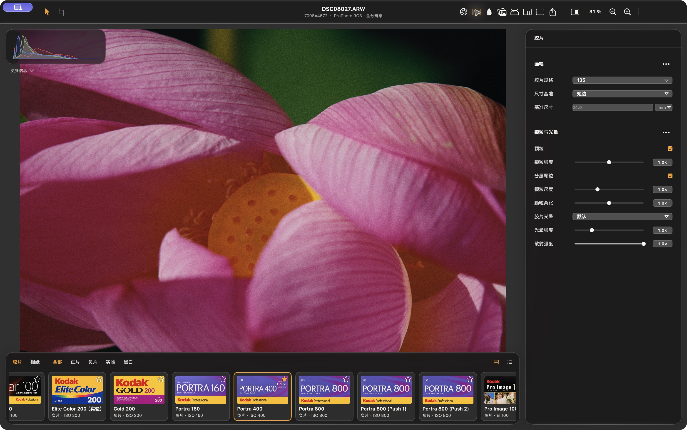

<p align="center">
  
</p>

<h1 align="center">Silverphase</h1>

<p align="center">
  <strong>从胶片曝光，到相纸成像。</strong><br>
  面向 macOS、iPhone 和 iPad 的原生胶片工艺模拟器
</p>

<p align="center">
  简体中文 · <a href="README.en.md">English</a> ·
  <a href="#下载">下载</a> · <a href="#编辑流程">编辑流程</a> ·
  <a href="#版本记录">版本记录</a> · <a href="docs/README.md">文档</a>
</p>

Silverphase 在设备上模拟 **相机输入 → 胶片曝光 → 显影 → 印相 → 扫描**。胶片和相纸共同决定成像，颗粒、光晕和片边在工艺流程中形成。可以直接交付成片，也可以输出保留胶片反差的 Cineon 中间文件。

## 也试试 Layerlight

<table>
  <tr>
    <td width="112" align="center"><a href="https://apps.apple.com/cn/app/layerlight-hdr-photo-editor/id6756343255"></a></td>
    <td>
      <strong>Layerlight · HDR 图片编辑器</strong><br>
      同一作者开发的独立闭源应用，已在 App Store 上架，支持 iPhone 与 iPad。
      <p>调整 HDR 高光与 Gain Map 光影层，控制光感、反差和柔和度；支持 HEIC 摄影风格工作流，并提供裁切、画框、水印与批量导出等功能。摄影风格编辑需要受支持的设备和系统；部分功能需 Pro。</p>
      <a href="https://apps.apple.com/cn/app/layerlight-hdr-photo-editor/id6756343255"><strong>在 App Store 查看与下载 →</strong></a>
    </td>
  </tr>
</table>

Layerlight 的应用与图标保留其独立权利，不适用 Silverphase 的开源许可。图标来源见[相关应用素材说明](screenshots/related-apps/README.md)。

## 下载

| 平台 | 下载入口 | 系统要求 |
|---|---|---|
| macOS | [1.3.0（构建 5）](https://github.com/akinal5765-byte/Silverphase/releases/tag/macos-v1.3.0) · Apple Silicon DMG | macOS 15 或更高 |
| iPhone／iPad | [App Store](https://apps.apple.com/hk/app/silverphase-%E8%83%B6%E7%89%87%E6%A8%A1%E6%8B%9F/id6829987567) · [TestFlight 测试版](https://testflight.apple.com/join/uwY3ZYJp) | iOS／iPadOS 18 或更高 |

macOS 可在「设置 → 软件更新」检查新版。GitHub DMG 使用 ad-hoc 签名，未经 Apple 公证。[安装与校验指南](docs/BINARY-RELEASES.md)

iPhone 和 iPad 的正式版在中国大陆区以外的 App Store 提供。可安装版本以 App Store 和 TestFlight 各自显示为准。

## 编辑流程

1. **打开照片。** 可使用普通图像或系统支持的 RAW 原片。RAW 兼容性取决于 Apple 的系统解码能力。
2. **选择材料。** 公开目录包含 25 款常规胶片配置、9 款相纸和 29 款实验胶片。彩色负片可印相，正片或选择「不使用相纸」可直扫。Ilford Multigrade IV RC 支持 00–5 级纸号。[完整材料目录](modern_UI/Spektrafilm/Spektrafilm/Resources/StockCatalog.json) · [实验配置来源与适用范围](license/DATA-SOURCES.md#experimental-fotufilm-profiles)
3. **按工艺调整。** 可以调整测光、白平衡、显影、颗粒、光晕、物理画幅与印相滤色，并加入片边和日期。
4. **导出。** 成片可选 JPEG、8 位 PNG 或 16 位 TIFF，写入所选色彩配置。Cineon DI 包含 16 位对数 TIFF 与配套的 ProPhoto RGB／Rec.709 视图 LUT，适合后续调色。[导出与 DI 说明](modern_UI/Spektrafilm/README.md#图像与输出边界)

## 各平台功能

### macOS

支持文件夹工作流、软打样和双照片半格组合。「模拟尺寸」可指定重裁切后的长边，让颗粒和光晕按目标尺寸生成。Lightroom Classic 可发送单张 JPEG 或 TIFF 副本，保存时全尺寸写回 Lightroom 登记的文件。输入保留 Lightroom 已渲染的影调。[macOS 指南](modern_UI/Spektrafilm/README.md) · [Lightroom Classic 工作流](docs/LIGHTROOM-CLASSIC.md)

### iPhone 与 iPad

可从「照片」或「文件」导入，也可直接拍摄。支持本地图库、评分与旗标、批量编辑与导出，并为常规 iPhone、iPhone Duo 和 iPad 提供各自的布局。[iOS 指南](ios/README.md) · [平台控制与设备限制](ios/CONTROL-AUDIT.md)

## 效果案例

下图来自 2026 年 10 月的桌面案例。不同胶片、100% 颗粒与光晕对照见[案例页](screenshots/current/README.md)。当前界面位置以各平台指南为准。



## 版本记录

| 平台 | 1.3.0 发布说明 |
|---|---|
| macOS（构建 5） | [GitHub Release](https://github.com/akinal5765-byte/Silverphase/releases/tag/macos-v1.3.0) · [改动与 5219 验证](modern_UI/Spektrafilm/releases/1.3.0.md) |
| iOS／iPadOS（构建 10） | [GitHub Release](https://github.com/akinal5765-byte/Silverphase/releases/tag/v1.3.0) · [源码与验证记录](ios/releases/1.3.0.md) |

1.3.0 在两端加入入片调整、受支持 RAW 的相机预览亮度匹配，以及 JPEG、PNG 和 TIFF 的 XMP 星级。共享目录加入 29 款实验胶片，并更新光谱适配、DIR、印相中性滤色和颗粒柔化。已有照片会保留旧影调设置。

## 文档与构建

两端采用 SwiftUI 和共享 C++20／Metal 引擎。Python 用于开发脚本，应用运行在设备端。

```sh
git clone https://github.com/akinal5765-byte/Silverphase.git
cd Silverphase
export DEVELOPER_DIR=/Applications/Xcode-27.1.app/Contents/Developer

SILVERPHASE_LOCAL_MATERIALS=0 engine/build.sh bundle
SILVERPHASE_LOCAL_MATERIALS=0 xcodebuild \
  -project modern_UI/Spektrafilm/Spektrafilm.xcodeproj \
  -scheme Spektrafilm -configuration Debug -derivedDataPath build/DerivedData build
open build/DerivedData/Build/Products/Debug/Silverphase.app
```

iOS 工程、真机签名及模拟器命令见 [iOS 构建指南](ios/README.md)。了解应用结构和验证方式，请看[文档索引](docs/README.md)、[共享引擎架构](ARCHITECTURE.md)和[验证指南](modern_UI/Spektrafilm/VALIDATION.md)。反馈问题或参与开发，请到 [Issues](https://github.com/akinal5765-byte/Silverphase/issues) 或查看[贡献指南](CONTRIBUTING.md)。

## 致谢与许可

- [spektrafilm](https://github.com/andreavolpato/spektrafilm) · 感谢 Andrea Volpato 提供胶片曝光、显影和印相的物理模型，以及原始实测胶片与相纸数据。
- [SpektraLab](https://github.com/JamesQiu2005/SpektraLab) · 感谢 Hanze Qiu 将 spektrafilm 的模型发展为可交互的胶片模拟工具。Silverphase 是 SpektraLab 的独立衍生项目。
- [Negs](https://github.com/noahhaasis/negs) · 感谢 Noah Haasis 的项目，以及 [yosoyelchris](https://github.com/yosoyelchris) 为 Negs 带来的入片调整和相机亮度匹配。感谢 MUAStudio 的 [Fotufilm](https://fotufilm.com) 提供实验胶片配置来源。

[许可与署名](LICENSES.md) · [材料数据来源](license/DATA-SOURCES.md)

<details>
<summary>Silverphase 1.3.0 借鉴 Negs 的细节</summary>

- **入片调整与相机亮度匹配** · 借鉴入片影调、细节与色彩控制，以及用相机预览拟合单张 RAW 起始曝光的做法。[Negs Prep](https://github.com/noahhaasis/negs/blob/479a5674bb9d43af5c08fbd7307b367bec7bf10b/docs/prep.md) · [Negs 作者署名](https://github.com/noahhaasis/negs#credits)
- **模拟尺寸与星级导出** · 借鉴胶片模拟前的线性重采样，以及导出时将照片星级写入 `xmp:Rating` 的做法。[Negs Image Size](https://github.com/noahhaasis/negs/blob/479a5674bb9d43af5c08fbd7307b367bec7bf10b/docs/image-size.md) · [Negs 照片管理与导出](https://github.com/noahhaasis/negs#a-darkroom-in-a-window)
- **29 款实验胶片** · 采用 Negs 从 MUAStudio 的 [Fotufilm](https://fotufilm.com) 转换的材料配置和部分显影、印相参数。[配置来源与许可](license/DATA-SOURCES.md#experimental-fotufilm-profiles) · [源文件与版本记录](engine/resources_product/UPSTREAM.json)
- **共享引擎校准** · 参考 Negs 对 Spektrafilm 实验模型的实现，包括 DIR 饱和响应、Hanatos 光谱窗口归一化和印相中性滤色求解。[DIR](https://github.com/noahhaasis/negs/blob/97d63aaebca9654b041211dea9eebd55dd12b878/crates/spektrafilm-model/src/couplers.rs) · [光谱适配](https://github.com/noahhaasis/negs/blob/97d63aaebca9654b041211dea9eebd55dd12b878/crates/spektrafilm-core/src/spectral_service.rs) · [印相平衡](https://github.com/noahhaasis/negs/blob/97d63aaebca9654b041211dea9eebd55dd12b878/crates/spektrafilm-core/src/print_balance.rs)
- **分阶段验证** · 参考 Negs 拆开管线逐级检查的办法，建立 Silverphase 自己的 Kodak 5219 底片、颗粒和光谱色样参考。[Negs 的验证报告](https://github.com/noahhaasis/negs/blob/479a5674bb9d43af5c08fbd7307b367bec7bf10b/docs/gpu-vs-cpu-quality.md) · [Silverphase 5219 验证](modern_UI/Spektrafilm/VALIDATION.md#5219-底片与光谱色样)

</details>
