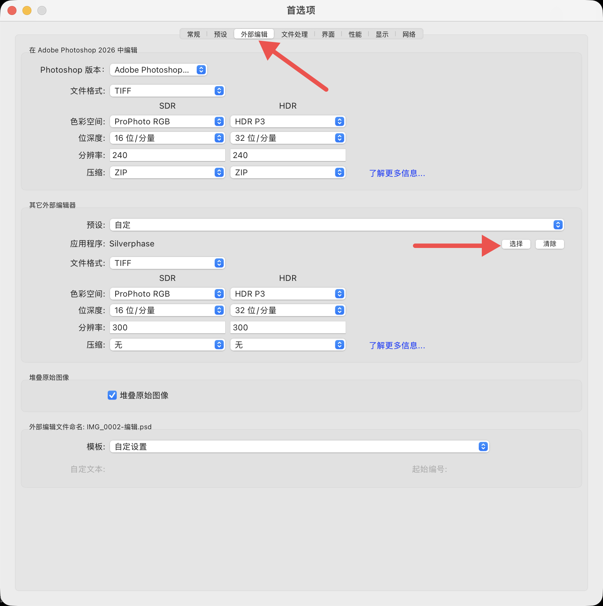
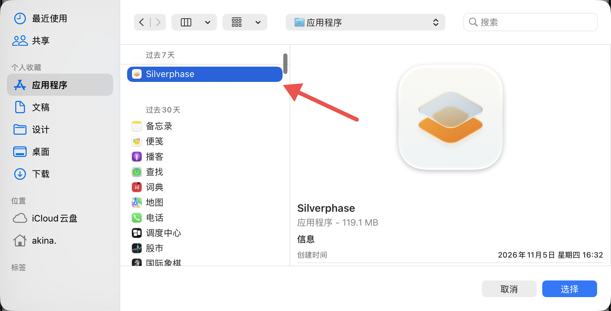
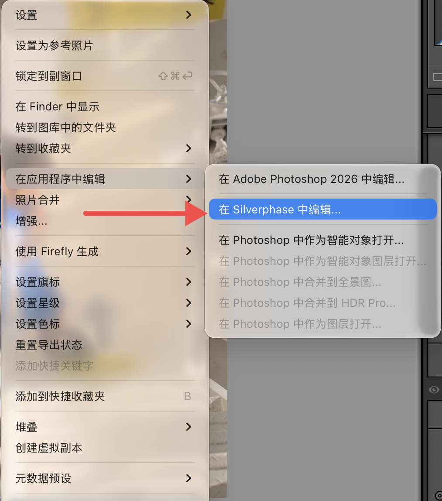

# Lightroom Classic external editing

[简体中文](LIGHTROOM-CLASSIC.md) · **English**

Silverphase 1.2.0 added a single-photo external-editing workflow for Lightroom Classic on macOS. It uses the installed Silverphase.app; no separate `.lrplugin` is required. This guide does not cover cloud Lightroom, mobile Lightroom, or a Photoshop plugin.

## 1. Set up the external editor

Install the new Silverphase in Applications and quit any older running version. In Lightroom Classic, open **Preferences → External Editing**. Under **Additional External Editor**, choose Silverphase.app from Applications. The Photoshop settings above that section do not control Silverphase.

| Setting | Recommendation |
|---|---|
| File format | TIFF |
| Output range | SDR |
| Colour space | ProPhoto RGB |
| Bit depth | 16 bits per component |
| Compression | None |

8-bit JPEG also works but is recompressed on save. More colour gamut or bit depth cannot undo tone already rendered by Lightroom. HDR, PSD, and batch round trips are outside this workflow. Save the setup as a named external-editor preset if you use it regularly.

## 2. Send a photo from Lightroom

Prepare the photo and its baseline tone in Lightroom. Right-click it and choose **Edit In → Edit in Silverphase…**.

If Lightroom asks what to edit on the first pass, choose **Edit a Copy with Lightroom Adjustments**. Lightroom bakes its current adjustments into a JPEG or TIFF copy and sends the copy to Silverphase. Keep the RAW source rather than using it as the overwrite target.

## 3. Save in Silverphase and return

When Silverphase identifies Lightroom as the sender, it presents the single-photo external editor:

- Photo navigation and Export are hidden. Film and paper are still available in the process panel.
- Choose **Save** (⌘S) at the top right to render full resolution and write back to the copy Lightroom registered.
- On success, Silverphase closes the editor and attempts to return to Lightroom. Open the corresponding copy there.
- Save is unavailable while adjustments are still pending or rendering, so an old result cannot be written back.
- On failure, the window stays open with an error. Finder requests for a different photo are also rejected while this session is active; finish or close the editor first.

The result retains the original JPEG/TIFF file type and embeds a ProPhoto RGB ICC profile. TIFF is written at 16 bits. Silverphase finishes a temporary file before replacing the destination. Closing without Save does not write a new image into Lightroom's copy, though recipe changes can remain in the Silverphase sidecar.

If the ordinary desktop interface opens without Save, check that Lightroom selected the new app and that no old process is running. Silverphase uses the sender in the macOS open-file event. A missing or forwarded sender is not inferred from the filename. Finder opens and drag-and-drop keep using the regular desktop workflow.

## 4. Lightroom tone versus RAW

The input is **the image Lightroom has already rendered**, not untouched RAW. Even with every Lightroom slider at zero, its profile and baseline tone differ from Silverphase's direct RAW decode. Identical recipes need not produce identical results.

You can start with a softer Lightroom baseline or adjust development and print contrast in Silverphase. Film and paper may add contrast to an already contrasty input. Silverphase does not reverse Lightroom's curve, compensate exposure for Lightroom, or silently select softer materials. The current recipe still controls automatic exposure. The 0.7 print contrast used in one experiment is not the external editor's default.

## 5. Edit again and retain the first input

On the first pass, Silverphase saves a hidden source alongside the copy as `.<filename>.silverphase-input.<extension>`. Subsequent sessions use that first input and its recipe; saving replaces only the copy registered by Lightroom. This avoids developing a previously processed result again.

Send the same copy from Lightroom to resume its Silverphase edit. To send fresh Lightroom adjustments, create a new edit copy at a different path. The same path continues to use the original retained input. Keep the hidden source and sidecar when moving, renaming, or cleaning up these photos. They are user data and should not be committed.

## Verification scope

The maintainer confirmed a one-photo round trip. The supplied screenshots are from November 9, 2026 and document where those Lightroom Classic options appeared. They do not establish support for all versions, launch states, HDR, or batch workflows. JPEG/TIFF preview-save consistency, cancellation, and failure recovery still need broader verification.
