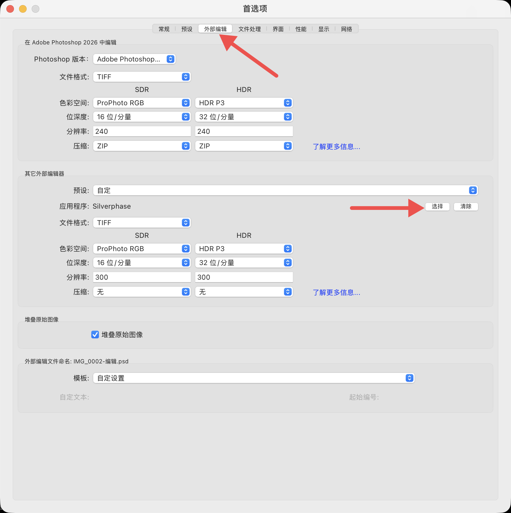
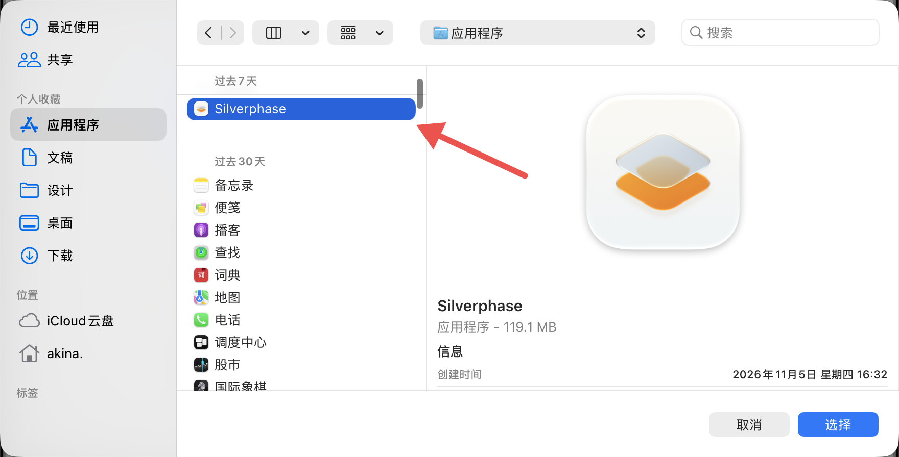
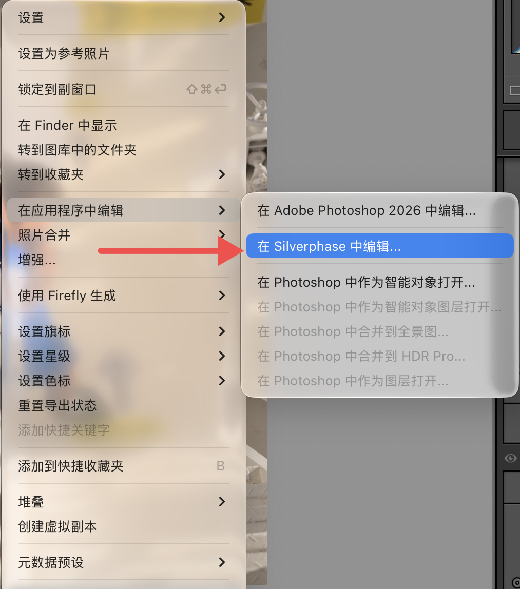

# Lightroom Classic 外部编辑

macOS 1.2.0 新增 Lightroom Classic 外部编辑流程。复用已安装的
Silverphase.app，无需另装 `.lrplugin`。本指南适用于 macOS 的 Lightroom
Classic，不包含 Lightroom 云端版、移动版或 Photoshop 插件。

## 1. 设置外部编辑器

安装新版 Silverphase 到「应用程序」，先退出仍在运行的旧版本。
在 Lightroom Classic 中打开「偏好设置 → 外部编辑」。
在下方「其它外部编辑器」区域点击「选择」，指定「应用程序」里的
Silverphase.app；上方的 Photoshop 设置不控制 Silverphase。

推荐设置：

| 设置 | 推荐值 |
|---|---|
| 文件格式 | TIFF |
| 输出范围 | SDR |
| 色彩空间 | ProPhoto RGB |
| 位深度 | 16 位／分量 |
| 压缩 | 无 |

也支持 8 位 JPEG，但保存时会再次有损压缩。更大的色域和更高位深不能
撤销 Lightroom 已经完成的影调处理。HDR、PSD 和批量往返不在本轮支持范围。
可将设置保存为命名的外部编辑器预设，方便再次选择。

## 2. 从 Lightroom 进入编辑

在 Lightroom 中准备好照片和基础影调，右键照片，选择
「在应用程序中编辑 → 在 Silverphase 中编辑…」。

若 Lightroom 显示编辑对象选项，首次处理请选择「编辑含 Lightroom 调整的副本」。
Lightroom 会把其当前调整烘焙到 JPEG／TIFF 副本，并把该副本交给 Silverphase。
请保留原始 RAW，不要把原文件作为覆盖目标。

## 3. 在 Silverphase 保存并返回

识别到 Lightroom 来源后，Silverphase 自动使用单张外部编辑界面：

- 不显示照片导航条和导出入口；胶片／相纸选择仍可从工艺面板打开。
- 右上角「保存」（⌘S）使用全分辨率处理，写回 Lightroom 传来的副本。
- 写入成功后关闭编辑窗口并尝试返回 Lightroom，查看对应副本。
- 保存失败时保留编辑窗口并显示错误，不关闭窗口冒充成功。

返回文件保留相应 JPEG／TIFF 格式，写入 ProPhoto RGB ICC；TIFF 为 16 位。
输出使用临时文件完成后替换目标。未点击「保存」而直接关窗，不会将
渲染成片写回 Lightroom 副本；编辑设置仍可能留存在 Silverphase 的 sidecar 中。

若显示的是普通桌面界面而没有「保存」，先确认 Lightroom 选择的是新版
应用并退出旧进程。来源识别依据 macOS 文件打开事件的发送应用；发送方
缺失或由其他程序代发时不会按文件名猜测。普通 Finder 打开、拖入文件
仍使用桌面编辑流程。

## 4. Lightroom 影调与 RAW 输入的区别

此流程的输入是 **Lightroom 当前渲染出的照片**，不是未经处理的 RAW。
即使 LR 中所有滑块为零，其解码配置与基础影调也不等于 Silverphase 的
直接 RAW 解码。插件与直接 RAW 使用相同参数，不保证得到相同结果。

用户可以先在 LR 中准备较柔和的基础影调，也可以在 Silverphase 中调整
胶片显影与印相反差。已有较强反差的输入，再经过胶片和印相后可能进一步
加重反差。Silverphase 不会自动逆转 Lightroom 曲线、补偿曝光，或为外部
编辑偷偷改用较低反差的材料设置。自动曝光仍由当前配方的开关决定。

本流程保留正常胶片／印相处理；实验中使用的印相反差 0.7 不是插件默认值。

## 5. 再次编辑与保留输入

首次接收时，Silverphase 在副本同目录保留隐藏输入：
`.<文件名>.silverphase-input.<扩展名>`。后续编辑使用该输入及其配方，
保存时只替换 Lightroom 登记的副本，避免把上次已处理的结果再次显影。

如果要沿用已有 Silverphase 编辑，可让 LR 交回同一文件。如果已在 LR
中作了新的调整，并希望把新调整交给 Silverphase，请创建新的编辑副本，
使用新的文件路径；同一路径会继续使用首次保留的输入。

隐藏输入和相关 sidecar 都是用户数据，应保留；不要把这些文件加入源码仓库。
移动、改名或清理文件时，应一并考虑保留输入，否则无法保证继续从首次输入编辑。

## 验证范围

本机用户已反馈单张往返流程跑通，并提供下方配置截图；截图由用户于
2026-11-09 提供，只说明该版本 Lightroom Classic 的菜单和配置位置。
它们不是所有 Lightroom 版本、启动状态、HDR 或批量路径的验证证据。
JPEG／TIFF 预览与保存一致性、取消及失败恢复等仍需进一步验收。
