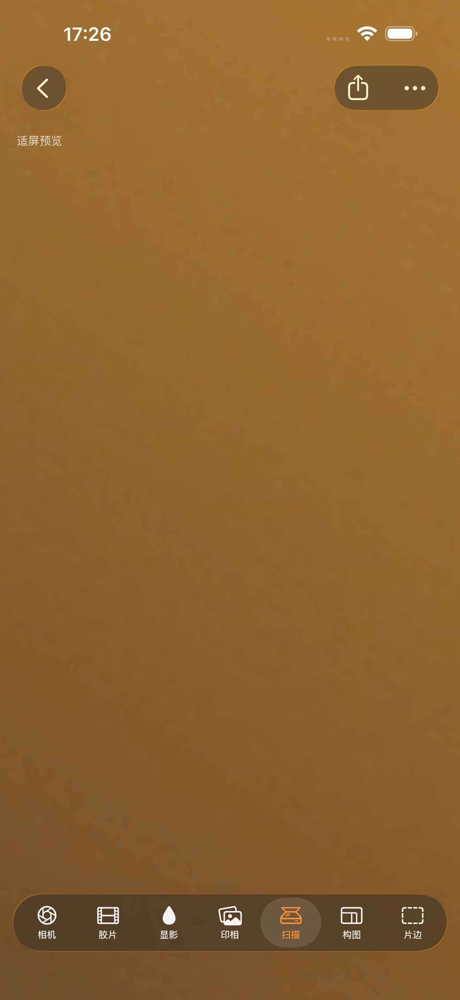
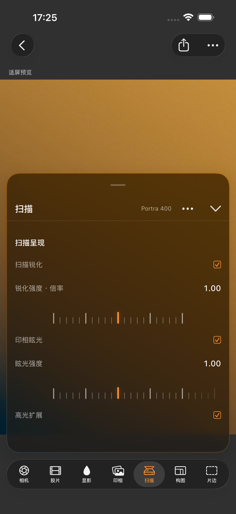
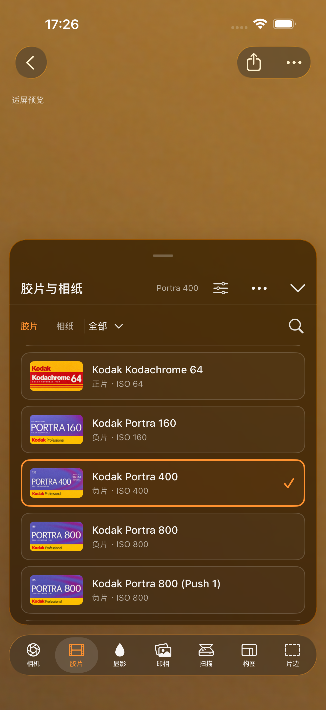
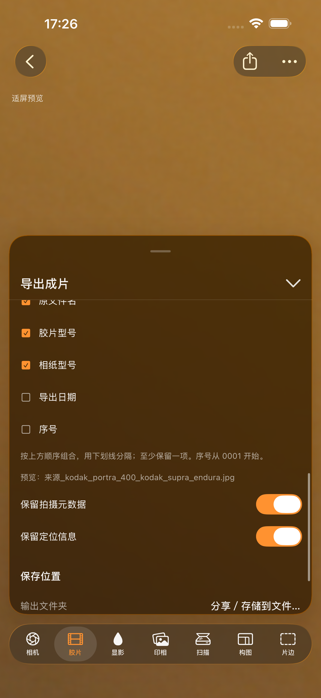
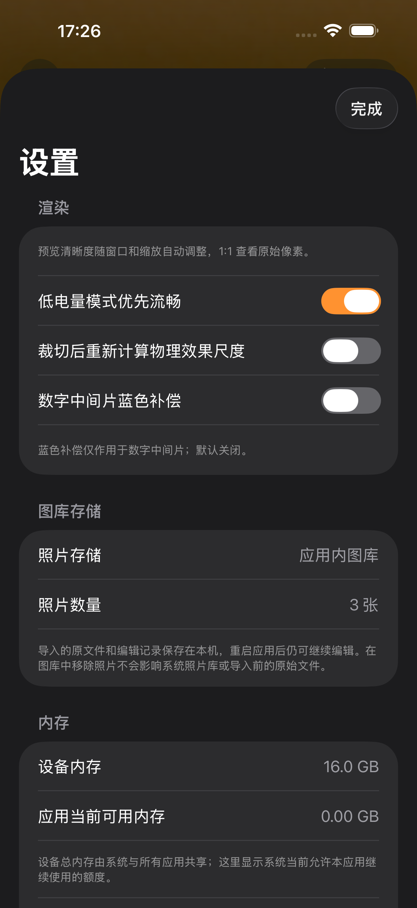

# 普通 iPhone 竖屏适配 — 2026-11-02

当前运行中的 Silverphase iOS 1.1.0（2），iPhone 17 Pro Max 模拟器、iOS26.1、
Xcode27.1。普通 iPhone 仅竖屏运行；本组不包含 Duo 或 iPad 图片。

画面输入是截图夹具生成的384×576渐变JPEG，不是私人照片。这组图片展示
布局与操作入口，不用来判断胶片色彩、颗粒效果、真机内存或实际文件导出。
PNG保留原始像素，未裁切、拼接、修饰或重绘；来源、尺寸与哈希见
[manifest.json](manifest.json)。

## 画布与浮动面板

顶部左侧返回，右侧导出与菜单；状态紧邻工具栏下方。照片可延伸至安全区
后方，底部七项工艺保持紧凑。右图为拖高后的扫描面板，内容在面板内滚动。
两图的照片缩放不同，不能作为像素一致性对比；画布变换保持另由聚焦回归检查。

| 收起面板／放大画布 | 展开扫描面板 |
|---|---|
|  |  |

## 胶片与相纸

普通 iPhone 使用上下滚动的材料列表，保留完整材料名、缩略图、类型和选中
标记。胶片／相纸可切换，分类通过菜单选择，搜索仍在标题行内。



## 导出命名与存储设置

文件名使用勾选项组合；设置明确显示应用内图库、照片数量与持久化说明。
设置中的内存读数属于模拟器，不能解释为 iPhone 的实际额度。

| 文件名勾选 | 图库存储设置 |
|---|---|
|  |  |

## 重新截图

此用例会重置目标模拟器中的示例图库，生成渐变输入，进入编辑器并操作界面。
材料列表和竖屏限制由单独聚焦用例验证。使用测试模拟器运行：

```sh
DEVELOPER_DIR=/Applications/Xcode-27.1.app/Contents/Developer \
SILVERPHASE_LOCAL_MATERIALS=0 \
xcodebuild -project ios/Silverphase/Silverphase.xcodeproj \
  -scheme SilverphaseUITests -configuration Debug \
  -destination 'platform=iOS Simulator,name=iPhone 17 Pro Max,OS=26.1' \
  -derivedDataPath /tmp/silverphase-ios-derived \
  -parallel-testing-enabled NO \
  -only-testing:SilverphaseUITests/PhotoImportTests/testCaptureCompactPhoneDocumentation \
  -only-testing:SilverphaseUITests/PhotoImportTests/testOrdinaryPhonePortraitAndVerticalMaterials \
  -resultBundlePath /tmp/silverphase-phone-docs.xcresult \
  CODE_SIGNING_ALLOWED=NO test
```

通过 `xcresulttool export attachments` 导出对应测试的 `Documentation - …` PNG，
检查画面，再更新本目录和哈希清单。不要保留旧横屏或横向材料条作为当前示例。
应用界面、自生成夹具及系统UI／字体／材料包装图沿用各自既有权利范围，
参见[素材说明](../../../license/ARTWORK.md)。
