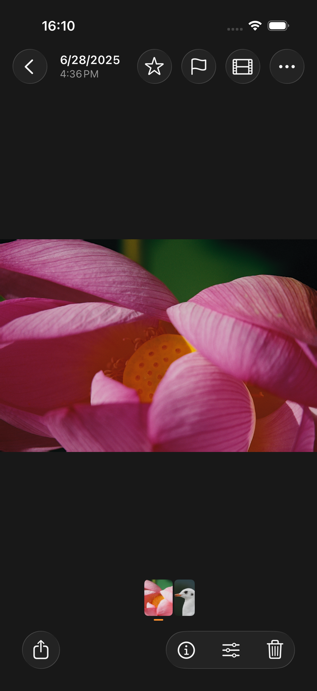
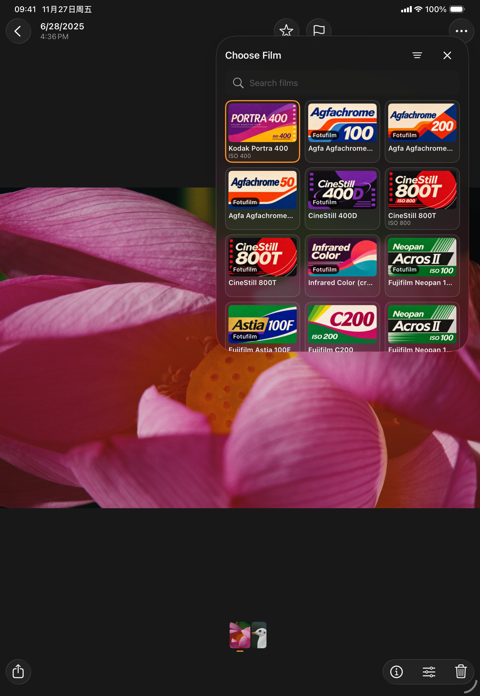

# Silverphase 1.4.0 · iPhone and iPad

[中文主页](../../../README.md) · [English home](../../../README.en.md) · [1.4.0 notes](../../../ios/releases/1.4.0.md)

这些是运行中的 Silverphase 1.4.0（构建 12）截图。图库打开真实拍摄的荷花和白鸟 RAW，照片由 App 解码和预览。不是合成界面，也不是旧版的渐变测试图。

These are screenshots of the running app, showing the 1.4.0 (12) release-source UI. The app imported and rendered approved RAW photographs of a lotus and a white bird. No mockup or synthetic photo was substituted.

The captures use isolated iPhone and iPad simulators. A temporary debug launch hook fed the two approved inputs through the ordinary importer; rendering and interface behavior use release source `7ef8fd4`. They are not physical-device, live-camera, or performance evidence. The source RAWs are not distributed.

Photo permission is limited to Silverphase project presentation. See the [original fixture and permission record](../../current/manifest.json), [artwork scope](../../../license/ARTWORK.md) and [capture manifest](manifest.json). The [November 2 synthetic-input captures](../2026-11-02/README.md) are retained as layout history.

## Screens / 界面

| iPhone 17 Pro | iPad Pro 11-inch |
|---|---|
| [图库／Library](iphone-library.png) | [看图／Viewer](ipad-viewer.png) |
| [看图／Viewer](iphone-viewer.png) | [选片／Film picker](ipad-film.png) |
| [选片／Film picker](iphone-film.png) | [照片信息／Photo Info](ipad-info.png) |
| [照片信息／Photo Info](iphone-info.png) | |

